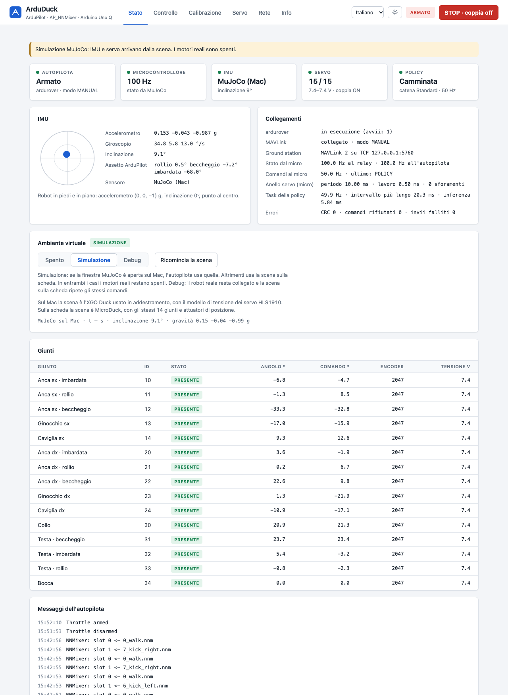
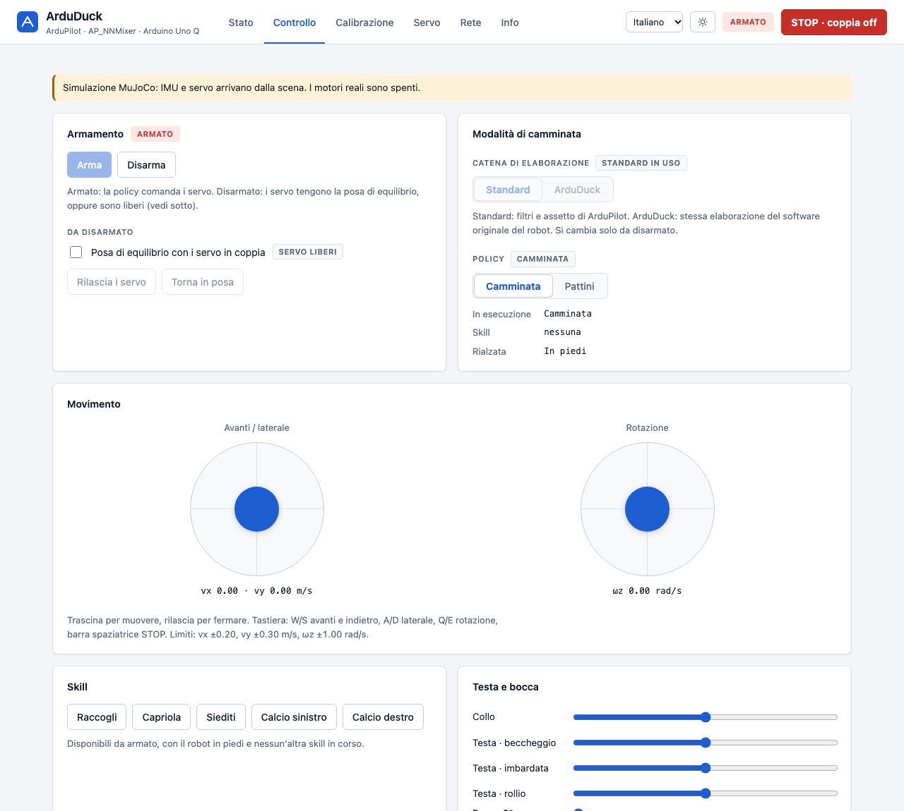
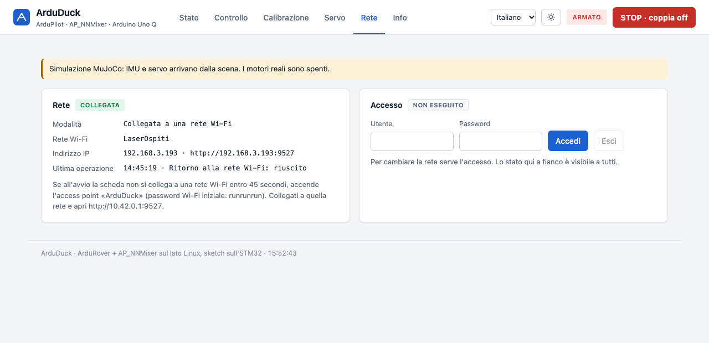
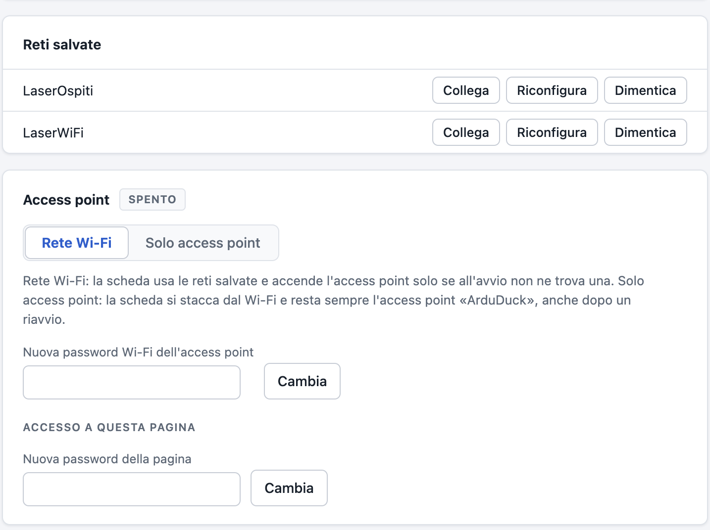
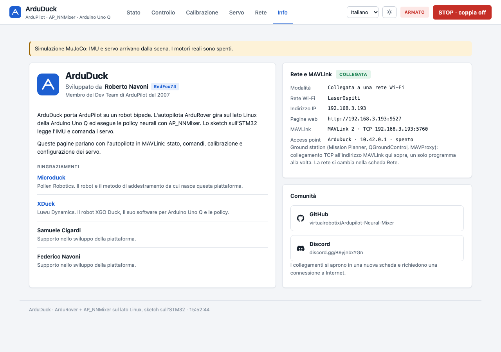
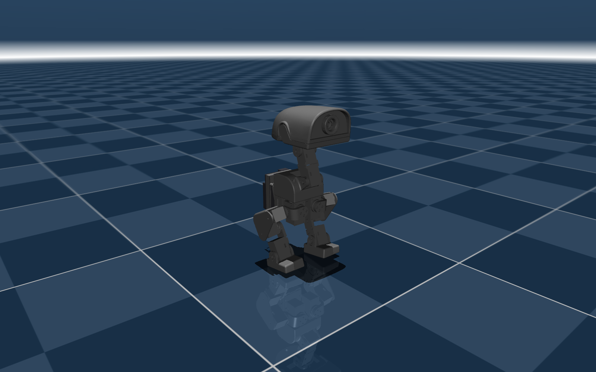

# ArduPilot Neural Mixer (AP_NNMixer)

[English](README.md) | **Italiano**

*Developed by Roberto Navoni — DelphyAI LAB · r.navoni74@gmail.com*

AP_NNMixer esegue una policy di locomozione appresa per rinforzo (PPO) **dentro ArduPilot**, come task del
firmware ArduRover. La rete legge IMU, RC e modalità di volo di ArduPilot e comanda i giunti del robot
attraverso le uscite servo di ArduPilot. Nessun computer di bordo aggiuntivo: la policy è C puro nel
firmware e i pesi si caricano dalla microSD.

Il robot di riferimento è [MicroDuck](docs/robots/microduck.md) (Pollen Robotics, 14 servo). Lo stesso
firmware e la stessa pipeline di training coprono un [catalogo di bipedi, quadrupedi e un esapode](docs/robots/README.md).

```
 GCS / MAVProxy ──MAVLink──▶ ArduRover ─ RC, modi ─▶ AP_NNMixer (PPO, 50 Hz) ─▶ SRV_Channels ─▶ giunti
                             AP_InertialSensor ───▶ filtro gravità + obs      ◀── feedback giunti
                             microSD /APM/nnm/<robot>/robot.bin + policies/*.nnm  → 2 slot int8 in RAM
```

Su un Arduino Uno Q lo stesso firmware comanda l'XGO Duck come **ArduDuck**, con le proprie pagine web e MuJoCo
su un computer host come corpo simulato: [Quickstart 3](#quickstart-3--arduduck-su-arduino-uno-q-mujoco-sul-computer-host).

Video demo: [`docs/media/demo_mavproxy_mlp.mp4`](docs/media/demo_mavproxy_mlp.mp4) (MAVProxy → ArduPilot →
rete → MuJoCo). Hardware-in-the-loop su Pixhawk 6C: [`docs/media/pixhawk6c_mlp_battery_imu.mp4`](docs/media/pixhawk6c_mlp_battery_imu.mp4).

## Cosa funziona oggi

| | Stato |
|---|---|
| MicroDuck in SITL con la pianta MuJoCo | sta in piedi, cammina, gira; batteria HIL 8/8 PASS |
| MicroDuck su Pixhawk 6C Mini (hardware-in-the-loop, build float32) | 15 s in piedi, forward p50 4,9 ms, CPU 32,8% |
| Policy da microSD, due slot int8, switch con fusione di 0,5 s | SITL: batteria 8/8 PASS con `walk.nnm` da SD (parità firmware vs `.nnm` 2,7e-7), test di switch 5/5; Pixhawk 6C: compila, non ancora provato sulla scheda |
| Twist da stick in MANUAL, HOLD, GUIDED / AUTO / RTL / SMART_RTL | nel firmware |
| Altri robot | 21 robot nel catalogo con profili, configurazioni PPO e scene MuJoCo. Microban `walk_md` cammina in simulazione ([it. 3000](docs/media/microban_walk_md_it3000.mp4)), saluta ([`wave_right`](docs/media/microban_wave_right_clip_it0300.mp4)) e balla ([`dance`](docs/media/microban_dance_it0400.mp4)) per imitazione di clip con un orologio dei gesti ([come](docs/robots/gesture_imitation.md)), si rialza da prono e da supino ([`getup`](docs/media/microban_getup.mp4)) e passa dal get-up alla camminata e alla teleop ([mix, it. 16500](docs/media/microban_getup_walk_teleop.mp4)). Freenove Robot Dog `walk_v23` cammina, regge le spinte e sale una rampa di 7° ([it. 10000](docs/media/freenove_walk_v23_it10000_full.mp4)). Booster T1 usa la policy upstream convertita in `.nnm` ([video](docs/media/booster_t1_walk_booster.mp4)); PhoneBot ha le prime walk in simulazione. I video dei checkpoint sono nella [scheda di ogni robot](docs/robots/README.md) |
| Teleoperazione della posa | MediaPipe sulla webcam della GCS → 8 canali `NNM_POSE` via MAVLink → `pose_cmd.nnm` di Microban, che esegue la posa e resta in equilibrio; provata in simulazione pura ([video](docs/media/microban_pose_cmd_mavlink_wave.mp4)) |
| Clip da motion capture | retargeting offline a corpo intero con `frax.ik` (MediaPipe o BVH → clip `.npz` → `--gesture motion`); pipeline verificata su dati sintetici, nessuna policy addestrata a fondo ([dettagli](#motion-capture-e-retargeting)) |
| ArduDuck: XGO Duck su Arduino Uno Q | ArduRover e le policy girano sulla scheda, con pagine web in quattro lingue, configurazione Wi-Fi con access point di riserva e MuJoCo su un computer host al posto del corpo: 100 Hz di stato e 50 Hz di comandi via USB e via Wi-Fi ([Quickstart 3](#quickstart-3--arduduck-su-arduino-uno-q-mujoco-sul-computer-host)) |
| Robot reale senza simulatore | serve un backend bus servo (Dynamixel / Feetech) per il feedback giunti, non ancora scritto |

---

## Quickstart 1 — firmware su un autopilota

Scheda provata: **Pixhawk 6C Mini** (STM32H743, flash 2 MB, microSD). Clonare in un percorso **senza
spazi**: la build ChibiOS fallisce con gli spazi nel percorso.

```bash
git clone --recurse-submodules https://github.com/virtualrobotix/Ardupilot-Neural-Mixer.git ~/nnmixer
cd ~/nnmixer
uv venv --python 3.12 && uv pip install -r requirements.txt
cd ardupilot
../.venv/bin/python ./waf configure --board Pixhawk6C-NNMixer
../.venv/bin/python ./waf rover --upload
```

Senza `--upload`, si carica `build/Pixhawk6C-NNMixer/bin/ardurover.apj` con QGroundControl o Mission Planner
(firmware personalizzato). Due target:

| Target | Flash usata | Contenuto |
|---|---:|---|
| `Pixhawk6C-NNMixer` | 1.947.204 B (18,9 KB liberi) | policy da SD + MLP float32 di MicroDuck in flash come riserva |
| `Pixhawk6C-NNMixerSD` | 1.154.888 B (811 KB liberi) | solo policy da SD; spazio per altre funzioni ArduPilot |

Altre schede ArduPilot: un H7 con microSD e circa 500 KB di heap libero. Si crea
`libraries/AP_HAL_ChibiOS/hwdef/<Scheda>-NNMixer/hwdef.dat` con `include ../<Scheda>/hwdef.dat` e
`define AP_NNMIXER_ENABLED 1` (più `define AP_NNMIXER_BAKED_MLP_ENABLED 0` se la flash è stretta).

**microSD.** Una cartella per robot, dentro solo le policy di quel robot:

```
/APM/nnm/microduck/robot.bin
/APM/nnm/microduck/policies/walk.nnm
```

Si copiano da [`sitl/APM/nnm/`](sitl/APM/nnm/) oppure da `robots/<id>/robot/robot.bin` e
`robots/<id>/policies/*.nnm`.

**Parametri** (poi riavvio):

| Parametro | Valore | Perché |
|---|---|---|
| `NNM_ENABLE` | 1 | attiva il task |
| `NNM_ROBOT` | indice del robot nel [catalogo](docs/robots/README.md) (MicroDuck 0) | topologia, letta al boot |
| `NNM_POLICY` | 0 | indice del file policy in ordine alfabetico; si cambia a caldo |
| `NNM_CLOCK_HZ` | 0 | orologio dei gesti / del passo: seno e coseno di una fase nei due canali dopo il twist (Microban saluto 0,5, balletto 0,625; Freenove walk_v21 1,5; Booster T1 1,0); 0 = canali a zero |
| `NNM_CLOCK_AUTO` | 0 | 1: l'orologio avanza solo con un twist comandato ed è zero da fermo (policy di locomozione addestrate con `env.gait_clock`, convenzione Booster Gym) |
| `NNM_POSE_WD` / `NNM_POSE_TAU` | 500 ms / 0,15 s | teleoperazione della posa via MAVLink (`DEBUG_FLOAT_ARRAY` nome `NNM_POSE`, Microban `pose_cmd.nnm`): watchdog oltre il quale gli 8 canali di posa tornano a riposo, e il passa-basso su di essi. Vedi [gesture_imitation.md](docs/robots/gesture_imitation.md#teleoperazione-posa-in-ingresso-via-mavlink) |
| `NNM_GAINS` | 1 | con una tabella `skills.bin` versione 2 (XGO Duck: KP/KD per servo), la invia al micro del bus da disarmato; il micro la applica a ogni ARM. 0 non la invia mai. Vedi [servo-guadagni-xgoduck.md](docs/servo-guadagni-xgoduck.md) |
| `SERVO1..14_FUNCTION` | 94..107 | uscite dei giunti (Scripting1..14) |
| `INS_GYRO_FILTER` | 0 | la policy vuole il gyro grezzo; i 4 Hz di default di Rover fanno cadere il bipede |
| `SCHED_LOOP_RATE` | 200 | filtro di gravità a 200 Hz, come in training |

[`sitl/nnmixer.parm`](sitl/nnmixer.parm) contiene l'insieme completo (su hardware si saltano le righe `SIM_*`).

**Prima accensione** (robot sospeso). Al boot la GCS mostra `NNMixer: robot microduck joints=14 obs=61` e
`NNMixer: loaded .../walk.nnm into slot 0`. Telemetria: `PPO_FAIL` 0 ok, 1 disarmato, 2 nessun feedback
giunti, 3 feedback vecchio; `PPO_PGZ` ≈ −1 in piedi; `PPO_SLOT` slot attivo. Oggi il feedback dei giunti
arriva dal ponte MuJoCo via USB:

```bash
.venv/bin/mjpython scripts/hil_mavlink_mujoco.py --port /dev/cu.usbmodem11201 --configure --seconds 30
```

---

## Quickstart 2 — SITL con MuJoCo (senza hardware)

```bash
cd ardupilot && ../.venv/bin/python ./waf configure --board sitl && ../.venv/bin/python ./waf rover && cd ..
.venv/bin/python scripts/demo_mavproxy.py            # finestra MuJoCo + SITL + sessione MAVProxy scriptata
```

La demo arma, sta in piedi, cammina avanti, indietro, di lato, gira di 90°, passa in HOLD e disarma.
`scripts/run_sitl.sh` copia `sitl/APM/nnm/` dove il SITL la vede come microSD. Sessione manuale e batteria
di test automatica: [documento di riferimento §8](docs/reference/microduck-ppo.it.md#8-demo-e-test).
`scripts/policy_switch_test.py` verifica lo switch a due slot (rimandato mentre cammina, eseguito in HOLD)
e il rifiuto del file di un altro robot.

---

## Quickstart 3 — ArduDuck su Arduino Uno Q, MuJoCo sul computer host

**ArduDuck** è l'XGO Duck (15 servo su bus) comandato da un **Arduino Uno Q**. ArduRover con AP_NNMixer gira
sul lato Linux della scheda, lo sketch dell'STM32 comanda il bus dei servo e l'IMU, e la scheda serve le
proprie pagine web. Sul robot non serve altro.

| Stato | Controllo |
|---|---|
|  |  |

### Novità

- **Pagine ArduDuck** su `http://<indirizzo della scheda>:9527`: Stato, Controllo, Calibrazione, Servo, Rete,
  Info.
- **Quattro lingue**: italiano, inglese, tedesco, spagnolo, dal selettore in alto. La scelta resta salvata nel
  browser; `?lang=it` (oppure `en`, `de`, `es`) nell'indirizzo la imposta direttamente.
- **Scheda Rete**: si sceglie una rete Wi-Fi, si riconfigura o si dimentica una rete salvata, oppure si stacca
  la scheda dal Wi-Fi così che funzioni solo il suo access point.
- **Access point di riserva**: se entro circa 45 s dall'avvio la scheda non entra in nessuna rete Wi-Fi,
  diventa l'access point `ArduDuck`.
- **Scheda Info**: rete attuale, indirizzo delle pagine e della porta MAVLink.
- **MuJoCo sul computer host** con il modello dell'XGO Duck usato in addestramento, via Wi-Fi o USB.
- **Disarmo se il simulatore sparisce**: se la finestra MuJoCo si chiude mentre l'autopilota è armato, la
  scheda disarma. Senza questo l'autopilota tornerebbe a comandare i servo reali.

### Rete

| Scheda Rete | Reti salvate e access point |
|---|---|
|  |  |

| | Valore |
|---|---|
| Nome dell'access point | `ArduDuck` |
| Password Wi-Fi dell'access point | `runrunrun` (WPA2; si cambia nella scheda Rete) |
| Indirizzo della scheda come access point | `10.42.0.1` |
| Accesso alle impostazioni di rete | utente `arduduck`, password `runrun` (iniziali; si cambiano nella scheda Rete) |
| Pagine web | `http://<indirizzo della scheda>:9527` |
| MAVLink (QGroundControl, Mission Planner, MAVProxy) | TCP `<indirizzo della scheda>:5760`, un client alla volta |
| MuJoCo sull'host | TCP `<indirizzo della scheda>:7000` |

Primo collegamento senza una rete nota: si accende la scheda, si aspettano circa 45 s, da telefono o computer
si entra nella rete Wi-Fi `ArduDuck`, si apre `http://10.42.0.1:9527`, si va in **Rete**, si fa l'accesso e si
sceglie la rete Wi-Fi. La scheda lascia l'access point ed entra in quella rete; il nuovo indirizzo compare in
**Rete** e in **Info**.

Due modi, scelti nella scheda Rete: **Wi-Fi con access point di riserva** (predefinito) e **solo access
point**, in cui la scheda ignora le reti salvate. Il modo resta dopo un riavvio.

Le pagine sono in HTTP semplice: l'accesso e le password Wi-Fi viaggiano in chiaro sulla rete. Conviene
cambiare le due password iniziali prima di usare il robot su una rete non propria.



### MuJoCo gira sul computer host, non sul robot

In simulazione la scheda continua a fare tutto quello che fa sul robot reale: ArduRover, la policy, i modi,
MAVLink e le pagine web girano sulla Uno Q. Si sostituisce solo il **corpo**. MuJoCo gira su un computer
(l'host: macOS, Windows o Linux) collegato in rete alla scheda, e fa la parte dei servo e dell'IMU.

```
   COMPUTER HOST (macOS / Windows / Linux)                 ARDUINO UNO Q (sul robot)
 ┌──────────────────────────────────────┐              ┌────────────────────────────────────────┐
 │ tools/unoq/mac_sim.py                │  TCP :7000   │ ArduRover + AP_NNMixer (policy, 50 Hz) │
 │  fisica MuJoCo + finestra 3D         │ ◀─────────── │  comandi dei giunti, 50 Hz             │
 │  XGO Duck usato in addestramento     │ ───────────▶ │  IMU e angoli simulati, 100 Hz         │
 └──────────────────────────────────────┘              │                                        │
 ┌──────────────────────────────────────┐  HTTP :9527  │ pagine web ArduDuck                    │
 │ browser (stesso o altro dispositivo) │ ◀──────────▶ │                                        │
 │ ground station (facoltativa)         │ ◀──────────▶ │ MAVLink                                │
 └──────────────────────────────────────┘  TCP :5760   │ servo reali: spenti in simulazione     │
                                                       └────────────────────────────────────────┘
        Wi-Fi (stessa rete, oppure l'access point ArduDuck)   oppure   cavo USB con adb forward
```

- È l'**host ad aprire la connessione** verso la scheda, sulla porta TCP 7000. Sul firewall dell'host non va
  aperto nulla; basta che l'host raggiunga l'indirizzo della scheda.
- Appena la finestra si collega, la scheda passa in **Simulazione**: l'autopilota legge IMU e angoli
  simulati e i suoi comandi vanno alla finestra. I servo reali restano spenti.
- Chiudendo la finestra la scheda torna al robot reale. Se l'autopilota era armato, viene disarmato.
- Si arma e si guida dalla pagina **Controllo** (o da una ground station) esattamente come con il robot reale.

Tre modi per collegare host e scheda:

| Collegamento | Comando sull'host | Note |
|---|---|---|
| Stessa rete Wi-Fi | `mac_sim.py --host <indirizzo della scheda>` | l'indirizzo è nella scheda **Info** |
| Access point ArduDuck | `mac_sim.py --host 10.42.0.1` | l'host entra nella rete Wi-Fi `ArduDuck`; non serve un router |
| Cavo USB | `adb forward tcp:7000 tcp:7000`, poi `mac_sim.py` | `adb forward tcp:9527 tcp:9527` porta anche le pagine su `http://127.0.0.1:9527` |

Misure con un Mac come host: via USB la scheda riceve 100 Hz di stato e manda 50 Hz di comandi. Via Wi-Fi
(scheda e Mac sulla stessa rete, ping 7–209 ms) ha ricevuto 98–116 Hz di stato e mandato 45–50 Hz di comandi.
L'USB è il collegamento più regolare; su una rete Wi-Fi carica il ritardo varia e il robot è più difficile da
tenere in equilibrio.



*Il modello dell'XGO Duck dello stack di addestramento (0,791 kg, modello di tensione dei servo HLS1910, gioco
di ±1,5°, zaino dell'elettronica), renderizzato dalla scena che usa la finestra sull'host.*

### Installare MuJoCo sull'host

Sull'host servono Python 3.10 o successivo (qui 3.12), Git e una sessione grafica con OpenGL. Bastano tre
pacchetti Python: `mujoco`, `numpy` e il modello dei servo `better-actuator-models`. I submodule del
repository non servono. Il modello del robot viene da un secondo repository, clonato in
`third_party/xgoduck_rl` (circa 90 MB).

I passi per macOS sono stati eseguiti su un ambiente pulito. I passi per Windows e Linux usano gli stessi
pacchetti e lo stesso script ma **non sono ancora stati eseguiti** su quei sistemi.

**macOS** (Apple Silicon o Intel)

```bash
xcode-select --install                      # Git, se manca
brew install python@3.12                    # oppure l'installer di python.org
git clone https://github.com/virtualrobotix/Ardupilot-Neural-Mixer.git arduduck
cd arduduck
git clone -b hd1910-standup https://github.com/ZXerniXZ/xgoduck_rl third_party/xgoduck_rl
python3.12 -m venv .venv
.venv/bin/pip install mujoco numpy "better-actuator-models @ git+https://github.com/Rhoban/bam.git@mjlab_frictionloss"
.venv/bin/mjpython tools/unoq/mac_sim.py --host 192.168.1.50      # l'indirizzo della scheda
```

Su macOS la finestra si apre solo con `mjpython`, installato insieme al pacchetto `mujoco`; con `python`
semplice fallisce.

**Windows** (10 o 11, PowerShell)

Si installano [Python 3.12](https://www.python.org/downloads/windows/) e [Git for Windows](https://git-scm.com/download/win), poi:

```powershell
git clone https://github.com/virtualrobotix/Ardupilot-Neural-Mixer.git arduduck
cd arduduck
git clone -b hd1910-standup https://github.com/ZXerniXZ/xgoduck_rl third_party/xgoduck_rl
py -3.12 -m venv .venv
.venv\Scripts\pip install mujoco numpy "better-actuator-models @ git+https://github.com/Rhoban/bam.git@mjlab_frictionloss"
.venv\Scripts\python tools\unoq\mac_sim.py --host 192.168.1.50
```

**Linux** (Ubuntu / Debian, sessione desktop)

```bash
sudo apt install git python3 python3-venv
git clone https://github.com/virtualrobotix/Ardupilot-Neural-Mixer.git arduduck
cd arduduck
git clone -b hd1910-standup https://github.com/ZXerniXZ/xgoduck_rl third_party/xgoduck_rl
python3 -m venv .venv
.venv/bin/pip install mujoco numpy "better-actuator-models @ git+https://github.com/Rhoban/bam.git@mjlab_frictionloss"
.venv/bin/python tools/unoq/mac_sim.py --host 192.168.1.50
```

**Verifica.** Il terminale scrive `collegato: l'autopilota usa questa finestra`. Nella pagina **Stato**
l'ambiente virtuale indica *Simulazione* e il motore è il MuJoCo dell'host (l'etichetta dice "MuJoCo sul Mac"
su qualsiasi host). Finché la scheda non è raggiungibile lo script scrive
`in attesa della Uno Q su <indirizzo>:7000` e riprova ogni secondo: si controllano l'indirizzo, che host e
scheda siano sulla stessa rete e che l'app ArduDuck sia in esecuzione. Le reti Wi-Fi per ospiti spesso isolano
i client; in quel caso si usa l'access point o il cavo USB.

**USB al posto del Wi-Fi.** `adb` arriva con Arduino App Lab (o con gli Android platform-tools). Con la
scheda sul cavo USB:

```bash
adb forward tcp:7000 tcp:7000
adb forward tcp:9527 tcp:9527
.venv/bin/mjpython tools/unoq/mac_sim.py        # senza --host: 127.0.0.1 è la scheda attraverso adb
```

### Installare l'app sulla scheda

```bash
unoq/build_ardurover.sh                 # ardurover aarch64 statico, compilato in Docker
.venv/bin/python tools/robots/import_xgoduck.py    # policy dell'XGO Duck → robots/xgoduck/policies/*.nnm (restano in locale)
unoq/deploy.sh                          # app, binario, robot e policy via adb; installa il servizio di rete
adb shell arduino-app-cli app start user:arduhumanoid
```

`unoq/deploy.sh --torque-off` serve al primo collegamento di un robot reale: l'autopilota non alimenta mai i
servo da disarmato.

---

## Robot supportati

La topologia si sceglie al boot (`NNM_ROBOT`); le policy si cambiano a caldo, solo fra quelle di quel
robot. Tutti i robot usano la rete di MicroDuck (MLP 512-256-128 ELU, pesi int8); cambiano solo le
dimensioni di ingresso e uscita.

| `NNM_ROBOT` | Robot | Tipo | Giunti | Obs | Policy nel repo | Ultimo video di training |
|---:|---|---|---:|---:|---|---|
| 0 | [MicroDuck](docs/robots/microduck.md) | bipede | 14 | 61 | `walk.nnm` | — |
| 1 | [Microban](docs/robots/microban.md) | umanoide | 18 | 73 | `walk.nnm`, `walk_md.nnm`, `wave_right.nnm`, `dance_arms.nnm`, `dance.nnm`, `pose_cmd.nnm`, `getup.nnm`, `getup_discover.nnm` | [`getup → walk → teleop`, it. 16500, 82500 epoche](docs/robots/microban.md#risultati-per-versione-di-ambiente-ed-epoca) |
| 2 | [Zeroth-01](docs/robots/zeroth.md) | umanoide | 20 | 69 | — | — |
| 3 | [Bimo](docs/robots/bimo.md) | bipede | 8 | 33 | — | — |
| 4 | [Legolas](docs/robots/legolas.md) | bipede | 10 | 39 | — | — |
| 5 | [Upkie](docs/robots/upkie.md) | bipede a ruote | 6 | 27 | — | — |
| 6 | [Rex / SpotMicro](docs/robots/rex.md) | quadrupede | 12 | 45 | — | — |
| 7 | [Yertle](docs/robots/yertle.md) | quadrupede | 12 | 45 | — | — |
| 8 | [AlbertPro](docs/robots/albert.md) | quadrupede | 8 | 33 | — | — |
| 9 | [Open Duck Mini v2](docs/robots/openduck.md) | bipede | 14 | 51 | — | — |
| 10 | [Freenove Robot Dog](docs/robots/freenove.md) | quadrupede | 12 | 47 | `walk_v23.nnm` (riferimento), `walk_v7`, `walk_v19`–`walk_v22` | [`walk_v23`, it. 10000, 50000 epoche](docs/robots/freenove.md#risultati-per-versione-di-ambiente-ed-epoca) |
| 11 | [Petoi Bittle (OpenCat)](docs/robots/bittle.md) | quadrupede | 8 | 33 | — | [passo OpenCat open-loop sul modello](docs/robots/bittle.md#risultati-per-versione-di-ambiente-ed-epoca) |
| 12 | [Booster T1](docs/robots/booster_t1.md) | umanoide | 12 | 47 | `walk_booster.nnm` (upstream convertita) | [`walk_booster`](docs/robots/booster_t1.md#risultati-per-versione-di-ambiente-ed-epoca) |
| 13 | [flybody (Drosophila)](docs/robots/flybody.md) | esapode | 18 | 63 | — | — |
| 14 | [Yanshee](docs/robots/yanshee.md) | umanoide | 17 | 60 | — | — |
| 15 | [TienKung (Walker)](docs/robots/tienkung.md) | umanoide | 20 | 69 | — | — |
| 16 | [ToddlerBot](docs/robots/toddlerbot.md) | umanoide | 12 | 45 | — | — |
| 17 | [Jumper](docs/robots/jumper.md) | esapode | 20 | 69 | — | — |
| 18 | [PhoneBot](docs/robots/phonebot.md) | bipede | 13 | 50 | `walk.nnm` e 8 varianti (`walk_fwd`, `walk_natural`, `walk_steps`…) | — |
| 19 | [PhoneBot invertito](docs/robots/phonebot_rev.md) | bipede | 13 | 50 | `walk.nnm`, `walk_it1800.nnm` | — |
| 20 | [Sprite (Sprite0825)](docs/robots/open_sprite.md) | umanoide | 31 | 102 | — | — |

Ogni pagina linka il repo originale, il file del modello, CAD e BOM, ed elenca giunti, `q0`, uscite servo,
il file di architettura PPO (`robots/<id>/robot/ppo.yaml`) e le policy disponibili. I robot con policy
elencano anche ogni video di checkpoint con la versione di ambiente e l'iterazione di training
(un'iterazione corrisponde a 5 epoche PPO). La tabella completa, con foto e stato, è in
[docs/robots/README.md](docs/robots/README.md), generata da `tools/robots/catalog.py`.

## Addestrare una policy che si installa così com'è

L'ambiente MuJoCo è già il deployment ArduPilot: fisica al loop rate dell'autopilota, gravità dal filtro IMU
del firmware, azione tagliata e codificata in PWM come nel firmware, osservazione ordinata dal profilo del
robot. L'actor si addestra sulla griglia int8 dalla prima iterazione, quindi il file `.nnm` è la rete
addestrata, senza quantizzazione successiva.

```bash
.venv/bin/python tools/robots/fetch_upstream.py --robot rex             # repo originale + scena MuJoCo
.venv/bin/python tools/robots/train_velocity.py --robot rex --name walk # PPO int8 sul contratto di deployment
.venv/bin/python tools/robots/train_velocity.py --robot rex --eval robots/rex/policies/walk.nnm
```

Dettagli, elenco dei comportamenti del firmware replicati e ricetta GPU (mjlab):
[docs/robots/training.md](docs/robots/training.md).

Opzioni avanzate di `train_velocity.py`:

- `--gesture` sceglie un gesto a tempo: `wave_right`, `dance`… per un preset, `pose_cmd` per la teleop,
  `getup_discover` e `getup` per il rialzarsi, `motion --motion <clip.npz>` per una clip da motion capture.
- `--init-nnm` / `--init-onnx` / `--resume` fanno da punto di partenza.

La ricetta di ogni gesto è in [gesture_imitation.md](docs/robots/gesture_imitation.md).

## Motion capture e retargeting

Due strumenti in `tools/mocap/` portano un movimento umano sul robot:

| | Retargeting geometrico ([`retarget_microban.py`](tools/mocap/retarget_microban.py)) | Retargeting `frax.ik` ([`retarget_frax.py`](tools/mocap/retarget_frax.py)) |
|---|---|---|
| Uso | teleop in tempo reale: [`mocap_gcs.py`](tools/mocap/mocap_gcs.py) → `NNM_POSE` → `pose_cmd.nnm` | clip offline da imitare con `--gesture motion` |
| Ingresso | webcam MediaPipe | landmark MediaPipe registrati, BVH (LAFAN1) |
| Uscita | 8 canali di posa | tutti i giunti della policy, `robots/<id>/motions/<nome>.npz` |
| Limiti | taglio a valle | range dei giunti, `NNM_ACT_MAX` e velocità dei servo come vincoli dell'IK |

[frax](https://github.com/StanfordASL/frax) (StanfordASL, MIT) è una libreria JAX di cinematica e
dinamica. Il suo IK differenziale si confronta con **GMR** (General Motion Retargeting, usato a monte
per il dataset di TienKung), rispetto al quale ha quattro vantaggi:

- **Velocità:** oltre 100 000 frame/s in batch, contro i 35–70 frame/s di GMR.
- **Contratto nel solutore:** il contratto di deployment ArduPilot è un vincolo dell'IK.
- **Nessuna configurazione dedicata:** non serve un file per robot, perché il modello si ricava dall'MJCF
  del catalogo.
- **Solutore sempre risolvibile:** trova una soluzione anche con bersagli irraggiungibili.

GMR resta più ricco di formati d'ingresso (SMPL-X, FBX, video, streaming) e ha già la configurazione per
TienKung e Booster T1. frax gira in un venv separato (`.venv-frax`, JAX ≥ 0.9.1). Setup, comandi, misure e
confronto completo sono in
[gesture_imitation.md](docs/robots/gesture_imitation.md#clip-da-motion-capture-retargeting-con-fraxik).

---

## Come funziona

- **Task a 50 Hz.** Osservazione nel frame FLU del tronco (gyro, gravità, posizioni e velocità dei giunti,
  azione precedente, twist), forward in C puro, azione tagliata, `q_target = q0 + azione`, PWM
  `1500 + q/0,003 µs`.
- **Gravità** da un piccolo filtro complementare solo-IMU al loop rate, non dall'EKF.
- **Robot e policy.** `robot.bin` fissa al boot giunti, dimensione dell'osservazione, `q0`, prima uscita servo
  e frequenza. I file `.nnm` portano l'id del robot; un file di un altro robot viene rifiutato.
- **Due slot in RAM.** La policy attiva si copia dalla SD in RAM e gira dalla RAM. Uno switch carica l'altro
  slot mentre la policy corrente continua, poi fonde le due uscite per `NNM_BLEND_MS` (500 ms). Gli switch
  sono accettati da disarmato o in HOLD.
- **Modi.** MANUAL: stick. HOLD: twist zero. GUIDED / AUTO / RTL / SMART_RTL: velocità e velocità di
  rotazione desiderate da Rover, saturate su `NNM_VX_MAX` / `NNM_WZ_MAX`. Disarmato: servo a riposo.

La storia completa di MicroDuck — training, contratto di osservazione, rete, export in C, test di parità,
protocollo SITL, modifiche ad ArduPilot e risultati — è nel [documento di riferimento](docs/reference/microduck-ppo.it.md).

## Documentazione

| Documento | Contenuto |
|---|---|
| [docs/reference/microduck-ppo.it.md](docs/reference/microduck-ppo.it.md) ([EN](docs/reference/microduck-ppo.md)) | integrazione MicroDuck in dettaglio, risultati, glossario |
| [docs/robots/README.md](docs/robots/README.md) | configurazioni dei robot e pagine per robot |
| [docs/robots/training.md](docs/robots/training.md) | training MuJoCo compatibile con ArduPilot, int8, imitazione di clip (MimicKit) |
| [docs/robots/gesture_imitation.md](docs/robots/gesture_imitation.md) | gesti per imitazione di clip (saluto, balletto): orologio dei gesti, reward, perché il reward scritto a mano falliva; clip da motion capture con `frax.ik` e confronto con GMR; teleoperazione della posa via MAVLink; get-up in due fasi |
| [docs/blog/ardupilot-forum-post.md](docs/blog/ardupilot-forum-post.md) | post per il forum ArduPilot (inglese) |
| [docs/architettura-integrazione.pdf](docs/architettura-integrazione.pdf) / [.pptx](docs/architettura-integrazione.pptx) | slide dell'architettura |
| [docs/progetto-nnmixer-ardupilot-ppo.md](docs/progetto-nnmixer-ardupilot-ppo.md) | documento di progetto |
| [docs/servo-guadagni-xgoduck.md](docs/servo-guadagni-xgoduck.md) | guadagni KP/KD dei servo dell'XGO Duck: dove stanno, valori attuali, tabella per servo, pagina di configurazione |

## Struttura del repository

| Percorso | Cosa |
|---|---|
| `ardupilot/` | submodule: [virtualrobotix/ardupilot](https://github.com/virtualrobotix/ardupilot/tree/microduck-ppo), branch `microduck-ppo` |
| `ardupilot/libraries/AP_NNMixer/` | il task, il caricatore da SD, forward int8 e float32 |
| `ardupilot/libraries/AP_HAL_ChibiOS/hwdef/Pixhawk6C-NNMixer*/` | target Pixhawk 6C |
| `robots/<id>/robot/` | `profile.json` (topologia), `ppo.yaml` (PPO + ambiente), `robot.bin`, `scene.xml` |
| `robots/<id>/policies/` | policy `.nnm` di quel robot (e `.onnx` di origine) |
| `robots/<id>/motions/` | clip dense da imitare (`.npz`: registrate dal get-up o ricavate con `retarget_frax.py`) |
| `sitl/APM/nnm/` | struttura microSD usata dal SITL |
| `tools/robots/` | catalogo, download upstream, ambiente a contratto, training int8, export, `robot.bin` |
| `tools/mocap/` | ground station MediaPipe per la teleop (`mocap_gcs.py`), retargeting geometrico e retargeting `frax.ik` |
| `tools/` | export ONNX → C di MicroDuck, test di parità, rollout di riferimento |
| `unoq/` | app ArduDuck per Arduino Uno Q: `app/python` (relay, gateway, API, rete), `app/assets` (pagine web, `i18n.js`), `app/sketch` (STM32), `app/tools` (servizio di rete), `build_ardurover.sh`, `deploy.sh` |
| `tools/unoq/` | lato host: `mac_sim.py` (finestra MuJoCo per macOS, Windows, Linux), `xgoduck_scene.py` (modello di addestramento dell'XGO Duck), test al banco e del gateway |
| `plant/mujoco_json_plant.py` | pianta MuJoCo per il SITL (SIM_JSON) |
| `scripts/` | avvio SITL e pianta, demo, batteria HIL, ponte HIL Pixhawk |
| `tests/` | `test_nnm_pipeline.py`: training int8 → `.nnm` → forward C del firmware; `test_retarget_frax.py`: clip `motion` nell'ambiente e cinematica URDF di frax = MuJoCo |
