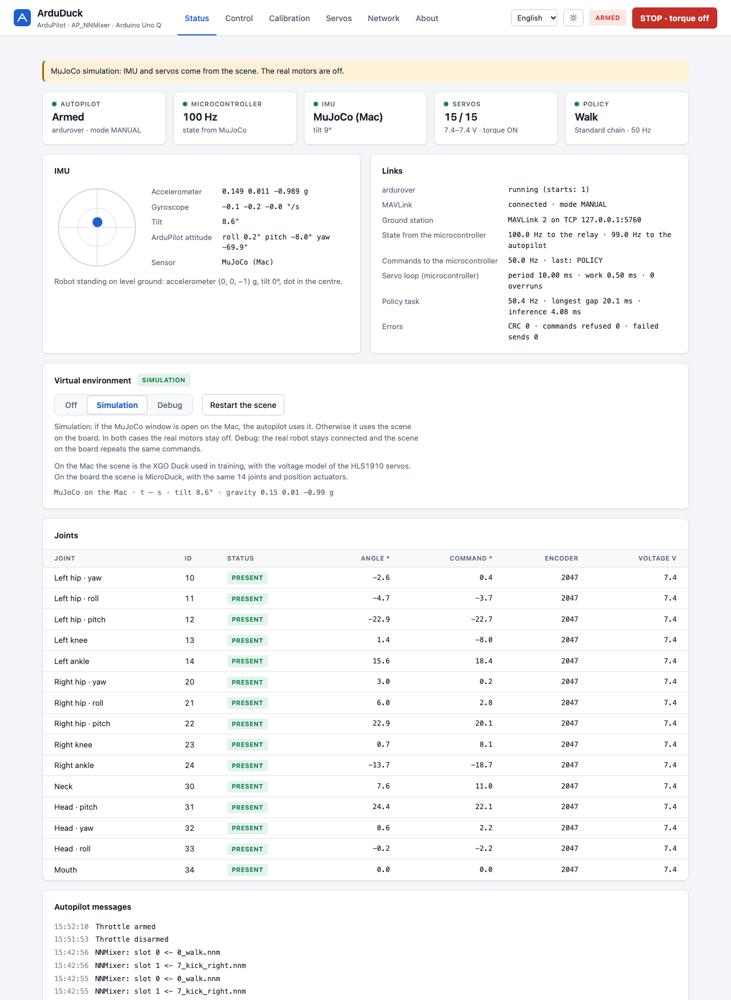
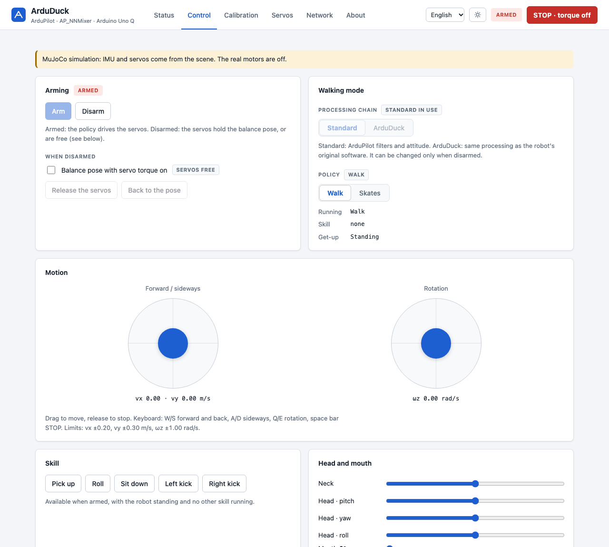
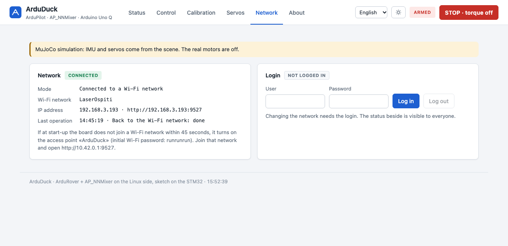
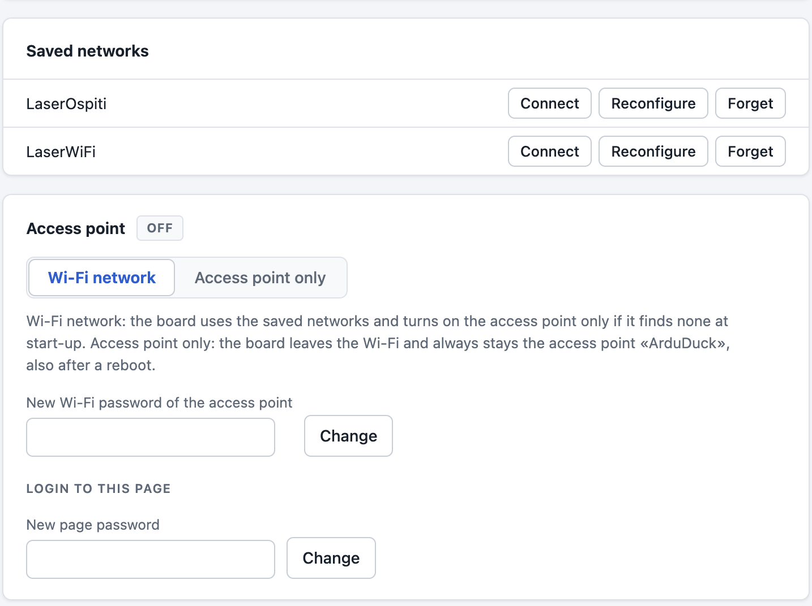
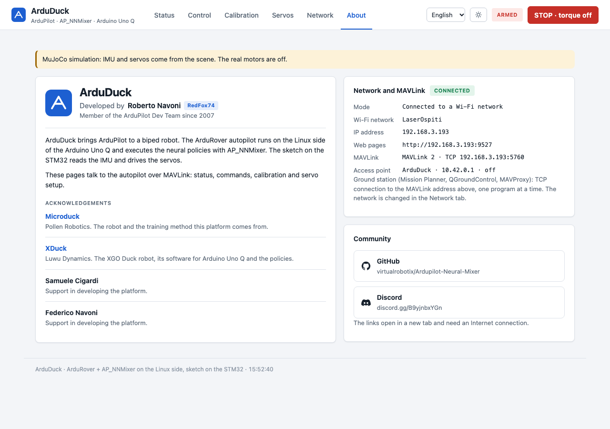
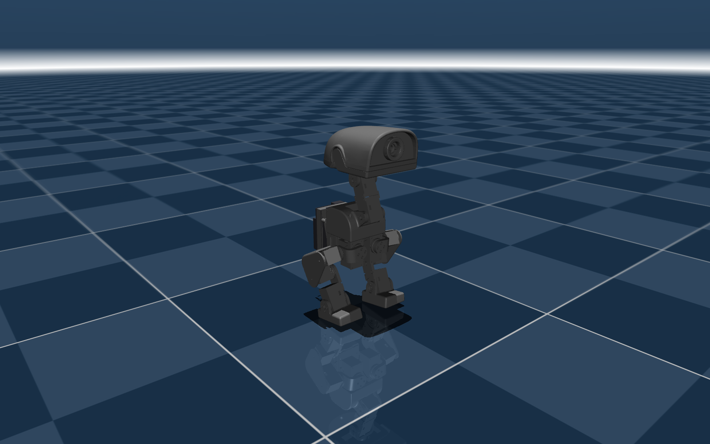

# ArduPilot Neural Mixer (AP_NNMixer)

**English** | [Italiano](README.it.md)

*Developed by Roberto Navoni — DelphyAI LAB · r.navoni74@gmail.com*

AP_NNMixer runs a reinforcement-learning locomotion policy (PPO) **inside ArduPilot**, as a scheduler
task of the ArduRover firmware. The network reads ArduPilot's IMU, RC and flight modes and drives the robot
joints through ArduPilot's servo outputs. No companion computer: the policy is plain C in the firmware, and
its weights are loaded from the microSD card.

The reference robot is [MicroDuck](docs/robots/microduck.md) (Pollen Robotics, 14 servos). The same firmware
and the same training pipeline cover a [catalog of bipeds, quadrupeds and a hexapod](docs/robots/README.md).

```
 GCS / MAVProxy ──MAVLink──▶ ArduRover ─ RC, modes ─▶ AP_NNMixer (PPO, 50 Hz) ─▶ SRV_Channels ─▶ joints
                             AP_InertialSensor ────▶ gravity filter + obs      ◀── joint feedback
                             microSD /APM/nnm/<robot>/robot.bin + policies/*.nnm  → 2 int8 slots in RAM
```

On an Arduino Uno Q the same firmware drives the XGO Duck as **ArduDuck**, with its own web pages and MuJoCo
on a host computer as the simulated body: [Quickstart 3](#quickstart-3--arduduck-on-arduino-uno-q-mujoco-on-the-host-computer).

Demo video: [`docs/media/demo_mavproxy_mlp.mp4`](docs/media/demo_mavproxy_mlp.mp4) (MAVProxy → ArduPilot →
network → MuJoCo). Pixhawk 6C hardware-in-the-loop: [`docs/media/pixhawk6c_mlp_battery_imu.mp4`](docs/media/pixhawk6c_mlp_battery_imu.mp4).

## What works today

| | Status |
|---|---|
| MicroDuck in SITL with the MuJoCo plant | stands, walks, turns; HIL battery 8/8 PASS |
| MicroDuck on a Pixhawk 6C Mini (hardware-in-the-loop, float32 build) | 15 s standing, forward pass p50 4.9 ms, CPU 32.8% |
| Policies from microSD, two int8 slots, switch with 0.5 s blend | SITL: battery 8/8 PASS with `walk.nnm` from SD (firmware vs `.nnm` parity 2.7e-7), switch test 5/5; Pixhawk 6C: builds, not yet run on the board |
| Twist from MANUAL sticks, HOLD, GUIDED / AUTO / RTL / SMART_RTL | in firmware |
| Other robots | 21 robots in the catalog with profiles, PPO configs and MuJoCo scenes. Microban `walk_md` walks in sim ([it. 3000](docs/media/microban_walk_md_it3000.mp4)), waves ([`wave_right`](docs/media/microban_wave_right_clip_it0300.mp4)) and dances ([`dance`](docs/media/microban_dance_it0400.mp4)) by clip imitation with a gesture clock ([how](docs/robots/gesture_imitation.md)), gets up from prone and supine ([`getup`](docs/media/microban_getup.mp4)) and hands over from get-up to walking and teleop ([mix, it. 16500](docs/media/microban_getup_walk_teleop.mp4)). Freenove Robot Dog `walk_v23` walks, rejects pushes and climbs a 7° ramp ([it. 10000](docs/media/freenove_walk_v23_it10000_full.mp4)). Booster T1 runs the upstream policy converted to `.nnm` ([video](docs/media/booster_t1_walk_booster.mp4)); PhoneBot has its first sim walks. Checkpoint videos are on each [robot page](docs/robots/README.md) |
| Pose teleoperation | MediaPipe on the GCS webcam → 8 `NNM_POSE` channels over MAVLink → Microban `pose_cmd.nnm`, which holds the pose and its balance; tested in pure simulation ([video](docs/media/microban_pose_cmd_mavlink_wave.mp4)) |
| Clips from motion capture | offline whole-body retargeting with `frax.ik` (MediaPipe or BVH → `.npz` clip → `--gesture motion`); pipeline checked on synthetic data, no policy fully trained yet ([details](#motion-capture-and-retargeting)) |
| ArduDuck: XGO Duck on Arduino Uno Q | ArduRover and the policies run on the board, with web pages in four languages, Wi-Fi setup with access point fallback, and MuJoCo on a host computer in place of the body: 100 Hz of state and 50 Hz of commands over USB and over Wi-Fi ([Quickstart 3](#quickstart-3--arduduck-on-arduino-uno-q-mujoco-on-the-host-computer)) |
| Real robot without the simulator | needs a servo-bus backend (Dynamixel / Feetech) for joint feedback, not written yet |

---

## Quickstart 1 — firmware on an autopilot

Tested board: **Pixhawk 6C Mini** (STM32H743, 2 MB flash, microSD). Clone into a path **without spaces**:
the ChibiOS build fails on paths with spaces.

```bash
git clone --recurse-submodules https://github.com/virtualrobotix/Ardupilot-Neural-Mixer.git ~/nnmixer
cd ~/nnmixer
uv venv --python 3.12 && uv pip install -r requirements.txt
cd ardupilot
../.venv/bin/python ./waf configure --board Pixhawk6C-NNMixer
../.venv/bin/python ./waf rover --upload
```

Without `--upload`, load `build/Pixhawk6C-NNMixer/bin/ardurover.apj` with QGroundControl or Mission Planner
(custom firmware). Two targets:

| Board target | Flash used | Contents |
|---|---:|---|
| `Pixhawk6C-NNMixer` | 1,947,204 B (18.9 KB free) | SD policies + MicroDuck float32 MLP in flash as fallback |
| `Pixhawk6C-NNMixerSD` | 1,154,888 B (811 KB free) | SD policies only; room for other ArduPilot features |

Other ArduPilot boards: an H7 with microSD and about 500 KB of free heap. Create
`libraries/AP_HAL_ChibiOS/hwdef/<Board>-NNMixer/hwdef.dat` with `include ../<Board>/hwdef.dat` and
`define AP_NNMIXER_ENABLED 1` (plus `define AP_NNMIXER_BAKED_MLP_ENABLED 0` if flash is tight).

**microSD.** One folder per robot, only that robot's policies inside:

```
/APM/nnm/microduck/robot.bin
/APM/nnm/microduck/policies/walk.nnm
```

Copy them from [`sitl/APM/nnm/`](sitl/APM/nnm/) or from `robots/<id>/robot/robot.bin` and
`robots/<id>/policies/*.nnm`.

**Parameters** (then reboot):

| Parameter | Value | Why |
|---|---|---|
| `NNM_ENABLE` | 1 | run the task |
| `NNM_ROBOT` | robot index from [the catalog](docs/robots/README.md) (MicroDuck 0) | topology, read at boot |
| `NNM_POLICY` | 0 | policy file index in alphabetical order; can change at runtime |
| `NNM_CLOCK_HZ` | 0 | gesture / gait clock: sin, cos of a phase in the two channels after the twist (Microban wave 0.5, dance 0.625; Freenove walk_v21 1.5, Booster T1 1.0); 0 = channels at zero |
| `NNM_CLOCK_AUTO` | 0 | 1: the clock runs only while a twist is commanded and is zero when standing (locomotion policies trained with `env.gait_clock`, Booster Gym convention) |
| `NNM_POSE_WD` / `NNM_POSE_TAU` | 500 ms / 0.15 s | pose teleop over MAVLink (`DEBUG_FLOAT_ARRAY` name `NNM_POSE`, Microban `pose_cmd.nnm`): watchdog after which the 8 pose channels ease back to rest, and the low-pass on them. See [gesture_imitation.md](docs/robots/gesture_imitation.md#teleoperazione-posa-in-ingresso-via-mavlink) |
| `NNM_GAINS` | 1 | with a `skills.bin` version 2 table (XGO Duck: KP/KD per servo), sends it to the joint-bus MCU while disarmed; the MCU applies it at every ARM. 0 never sends it. See [servo-guadagni-xgoduck.md](docs/servo-guadagni-xgoduck.md) (Italian) |
| `SERVO1..14_FUNCTION` | 94..107 | joint outputs (Scripting1..14) |
| `INS_GYRO_FILTER` | 0 | the policy needs the raw gyro; Rover's default 4 Hz makes the biped fall |
| `SCHED_LOOP_RATE` | 200 | gravity filter at 200 Hz, as in training |

[`sitl/nnmixer.parm`](sitl/nnmixer.parm) has the full set (skip the `SIM_*` lines on hardware).

**First run** (robot suspended). At boot the GCS shows `NNMixer: robot microduck joints=14 obs=61` and
`NNMixer: loaded .../walk.nnm into slot 0`. Telemetry: `PPO_FAIL` 0 ok, 1 disarmed, 2 no joint feedback,
3 stale feedback; `PPO_PGZ` ≈ −1 when upright; `PPO_SLOT` active slot. Today joint feedback comes from the
MuJoCo bridge over USB:

```bash
.venv/bin/mjpython scripts/hil_mavlink_mujoco.py --port /dev/cu.usbmodem11201 --configure --seconds 30
```

---

## Quickstart 2 — SITL with MuJoCo (no hardware)

```bash
cd ardupilot && ../.venv/bin/python ./waf configure --board sitl && ../.venv/bin/python ./waf rover && cd ..
.venv/bin/python scripts/demo_mavproxy.py            # MuJoCo window + SITL + scripted MAVProxy session
```

The demo arms, stands, walks forward, backward, sideways, turns 90°, switches to HOLD and disarms.
`scripts/run_sitl.sh` copies `sitl/APM/nnm/` where SITL sees it as the microSD. Manual session and the
automatic test battery: [reference document §8](docs/reference/microduck-ppo.md#8-running-the-demo-and-the-tests).
`scripts/policy_switch_test.py` checks the two-slot switch (deferred while walking, done in HOLD) and the
rejection of another robot's file.

---

## Quickstart 3 — ArduDuck on Arduino Uno Q, MuJoCo on the host computer

**ArduDuck** is the XGO Duck (15 bus servos) driven by an **Arduino Uno Q**. ArduRover with AP_NNMixer runs
on the Linux side of the board, the STM32 sketch drives the servo bus and the IMU, and the board serves its
own web pages. Nothing else is needed on the robot.

| Status | Control |
|---|---|
|  |  |

### What is new

- **ArduDuck pages** on `http://<board address>:9527`: Status, Control, Calibration, Servo, Network, About.
- **Four languages**: Italian, English, German, Spanish, from the selector in the header. The choice is
  remembered by the browser; `?lang=en` (or `it`, `de`, `es`) in the address sets it directly.
- **Network tab**: choose a Wi-Fi network, reconfigure or forget a saved one, or detach the board from Wi-Fi so
  that only its own access point works.
- **Access point fallback**: when the board joins no Wi-Fi network within about 45 s of start-up, it becomes
  the access point `ArduDuck`.
- **About tab**: current network, address of the pages and of the MAVLink port.
- **MuJoCo on the host computer** with the XGO Duck model used in training, over Wi-Fi or USB.
- **Disarm on simulator loss**: if the MuJoCo window disappears while the autopilot is armed, the board
  disarms. Without this the autopilot would go back to commanding the real servos.

### Network

| Network tab | Saved networks and access point |
|---|---|
|  |  |

| | Value |
|---|---|
| Access point name | `ArduDuck` |
| Access point Wi-Fi password | `runrunrun` (WPA2; can be changed in the Network tab) |
| Board address as access point | `10.42.0.1` |
| Login for the network settings | user `arduduck`, password `runrun` (initial; can be changed in the Network tab) |
| Web pages | `http://<board address>:9527` |
| MAVLink (QGroundControl, Mission Planner, MAVProxy) | TCP `<board address>:5760`, one client at a time |
| MuJoCo on the host | TCP `<board address>:7000` |

First connection without a known network: power the board, wait about 45 s, join the Wi-Fi network `ArduDuck`
from a phone or computer, open `http://10.42.0.1:9527`, go to **Network**, log in and choose the Wi-Fi network.
The board leaves the access point and joins it; its new address is shown in **Network** and **About**.

Two modes, chosen in the Network tab: **Wi-Fi with access point as fallback** (default) and **access point
only**, where the board ignores the saved networks. The mode survives a reboot.

The pages are plain HTTP: the login and the Wi-Fi passwords travel unencrypted on the network. Change the two
initial passwords before using the robot on a network that is not yours.



### MuJoCo runs on the host computer, not on the robot

In simulation the board keeps doing everything it does on the real robot: ArduRover, the policy, the modes,
MAVLink and the web pages all run on the Uno Q. Only the **body** is replaced. MuJoCo runs on a computer
(the host: macOS, Windows or Linux) connected to the board over the network, and plays the role of servos and
IMU.

```
   HOST COMPUTER (macOS / Windows / Linux)                 ARDUINO UNO Q (on the robot)
 ┌──────────────────────────────────────┐              ┌────────────────────────────────────────┐
 │ tools/unoq/mac_sim.py                │  TCP :7000   │ ArduRover + AP_NNMixer (policy, 50 Hz) │
 │  MuJoCo physics + 3D window          │ ◀─────────── │  joint commands, 50 Hz                 │
 │  XGO Duck model used in training     │ ───────────▶ │  simulated IMU + joint angles, 100 Hz  │
 └──────────────────────────────────────┘              │                                        │
 ┌──────────────────────────────────────┐  HTTP :9527  │ ArduDuck web pages                     │
 │ browser (same or another device)     │ ◀──────────▶ │                                        │
 │ ground station (optional)            │ ◀──────────▶ │ MAVLink                                │
 └──────────────────────────────────────┘  TCP :5760   │ real servos: off while simulating      │
                                                       └────────────────────────────────────────┘
        Wi-Fi (same network, or the ArduDuck access point)   or   USB cable with adb forward
```

- The **host starts the connection** to the board on TCP port 7000. Nothing has to be opened on the host
  firewall; the host only needs to reach the board's address.
- As soon as the window connects, the board switches to **Simulation**: the autopilot reads the simulated
  IMU and joint angles, and its commands go to the window. The real servos stay off.
- Closing the window gives the board back to the real robot. If the autopilot was armed, it is disarmed.
- Arm and drive from the **Control** page (or from a ground station) exactly as with the real robot.

Three ways to connect host and board:

| Link | Command on the host | Notes |
|---|---|---|
| Same Wi-Fi network | `mac_sim.py --host <board address>` | the address is in the **About** tab |
| ArduDuck access point | `mac_sim.py --host 10.42.0.1` | the host joins the Wi-Fi network `ArduDuck`; no router needed |
| USB cable | `adb forward tcp:7000 tcp:7000`, then `mac_sim.py` | `adb forward tcp:9527 tcp:9527` also brings the pages to `http://127.0.0.1:9527` |

Measured with a Mac as host: over USB the board receives 100 Hz of state and sends 50 Hz of commands. Over
Wi-Fi (board and Mac on the same network, ping 7–209 ms) it received 98–116 Hz of state and sent 45–50 Hz of
commands. USB is the steadier link; on a busy Wi-Fi network the delay varies and the robot is harder to keep
balanced.



*The XGO Duck model of the training stack (0.791 kg, HLS1910 servo voltage model, ±1.5° gear play, electronics
backpack), rendered from the scene the host window uses.*

### Installing MuJoCo on the host

The host needs Python 3.10 or later (3.12 used here), Git, and a graphical session with OpenGL. Three Python
packages are enough: `mujoco`, `numpy` and the servo model `better-actuator-models`. The repository
submodules are not needed. The robot model comes from a second repository, cloned into `third_party/xgoduck_rl`
(about 90 MB).

The macOS steps were run on a clean environment. The Windows and Linux steps use the same packages and the
same script but **have not been run** on those systems yet.

**macOS** (Apple Silicon or Intel)

```bash
xcode-select --install                      # Git, if missing
brew install python@3.12                    # or the installer from python.org
git clone https://github.com/virtualrobotix/Ardupilot-Neural-Mixer.git arduduck
cd arduduck
git clone -b hd1910-standup https://github.com/ZXerniXZ/xgoduck_rl third_party/xgoduck_rl
python3.12 -m venv .venv
.venv/bin/pip install mujoco numpy "better-actuator-models @ git+https://github.com/Rhoban/bam.git@mjlab_frictionloss"
.venv/bin/mjpython tools/unoq/mac_sim.py --host 192.168.1.50      # the board's address
```

On macOS the window opens only under `mjpython`, which is installed with the `mujoco` package; plain `python`
fails.

**Windows** (10 or 11, PowerShell)

Install [Python 3.12](https://www.python.org/downloads/windows/) and [Git for Windows](https://git-scm.com/download/win), then:

```powershell
git clone https://github.com/virtualrobotix/Ardupilot-Neural-Mixer.git arduduck
cd arduduck
git clone -b hd1910-standup https://github.com/ZXerniXZ/xgoduck_rl third_party/xgoduck_rl
py -3.12 -m venv .venv
.venv\Scripts\pip install mujoco numpy "better-actuator-models @ git+https://github.com/Rhoban/bam.git@mjlab_frictionloss"
.venv\Scripts\python tools\unoq\mac_sim.py --host 192.168.1.50
```

**Linux** (Ubuntu / Debian, desktop session)

```bash
sudo apt install git python3 python3-venv
git clone https://github.com/virtualrobotix/Ardupilot-Neural-Mixer.git arduduck
cd arduduck
git clone -b hd1910-standup https://github.com/ZXerniXZ/xgoduck_rl third_party/xgoduck_rl
python3 -m venv .venv
.venv/bin/pip install mujoco numpy "better-actuator-models @ git+https://github.com/Rhoban/bam.git@mjlab_frictionloss"
.venv/bin/python tools/unoq/mac_sim.py --host 192.168.1.50
```

**Check.** The terminal prints `collegato: l'autopilota usa questa finestra` (connected: the autopilot uses
this window). In the **Status** page the virtual environment reads *Simulation* and the engine is the host
MuJoCo (the label says "MuJoCo on the Mac" on every host). While the board is unreachable the script prints
`in attesa della Uno Q su <address>:7000` and retries every second: check the address, that host and board
are on the same network, and that the ArduDuck app is running. Guest Wi-Fi networks often isolate their
clients; in that case use the access point or the USB cable.

**USB instead of Wi-Fi.** `adb` comes with Arduino App Lab (or with Android platform-tools). With the board
on the USB cable:

```bash
adb forward tcp:7000 tcp:7000
adb forward tcp:9527 tcp:9527
.venv/bin/mjpython tools/unoq/mac_sim.py        # no --host: 127.0.0.1 is the board through adb
```

### Installing the app on the board

```bash
unoq/build_ardurover.sh                 # static aarch64 ardurover, built in Docker
.venv/bin/python tools/robots/import_xgoduck.py    # XGO Duck policies → robots/xgoduck/policies/*.nnm (kept local)
unoq/deploy.sh                          # app, binary, robot and policies over adb; installs the network service
adb shell arduino-app-cli app start user:arduhumanoid
```

`unoq/deploy.sh --torque-off` is for the first connection of a real robot: the autopilot never powers the
servos while disarmed.

---

## Supported robots

Topology is chosen at boot (`NNM_ROBOT`); policies can be switched at runtime, only among those of that
robot. All robots use the MicroDuck network (MLP 512-256-128 ELU, int8 weights); only input and output sizes
change.

| `NNM_ROBOT` | Robot | Type | Joints | Obs | Policy in repo | Latest training video |
|---:|---|---|---:|---:|---|---|
| 0 | [MicroDuck](docs/robots/microduck.md) | biped | 14 | 61 | `walk.nnm` | — |
| 1 | [Microban](docs/robots/microban.md) | humanoid | 18 | 73 | `walk.nnm`, `walk_md.nnm`, `wave_right.nnm`, `dance_arms.nnm`, `dance.nnm`, `pose_cmd.nnm`, `getup.nnm`, `getup_discover.nnm` | [`getup → walk → teleop`, it. 16500, 82500 epochs](docs/robots/microban.md#risultati-per-versione-di-ambiente-ed-epoca) |
| 2 | [Zeroth-01](docs/robots/zeroth.md) | humanoid | 20 | 69 | — | — |
| 3 | [Bimo](docs/robots/bimo.md) | biped | 8 | 33 | — | — |
| 4 | [Legolas](docs/robots/legolas.md) | biped | 10 | 39 | — | — |
| 5 | [Upkie](docs/robots/upkie.md) | wheeled biped | 6 | 27 | — | — |
| 6 | [Rex / SpotMicro](docs/robots/rex.md) | quadruped | 12 | 45 | — | — |
| 7 | [Yertle](docs/robots/yertle.md) | quadruped | 12 | 45 | — | — |
| 8 | [AlbertPro](docs/robots/albert.md) | quadruped | 8 | 33 | — | — |
| 9 | [Open Duck Mini v2](docs/robots/openduck.md) | biped | 14 | 51 | — | — |
| 10 | [Freenove Robot Dog](docs/robots/freenove.md) | quadruped | 12 | 47 | `walk_v23.nnm` (reference), `walk_v7`, `walk_v19`–`walk_v22` | [`walk_v23`, it. 10000, 50000 epochs](docs/robots/freenove.md#risultati-per-versione-di-ambiente-ed-epoca) |
| 11 | [Petoi Bittle (OpenCat)](docs/robots/bittle.md) | quadruped | 8 | 33 | — | [OpenCat open-loop gait on the model](docs/robots/bittle.md#risultati-per-versione-di-ambiente-ed-epoca) |
| 12 | [Booster T1](docs/robots/booster_t1.md) | humanoid | 12 | 47 | `walk_booster.nnm` (converted upstream) | [`walk_booster`](docs/robots/booster_t1.md#risultati-per-versione-di-ambiente-ed-epoca) |
| 13 | [flybody (Drosophila)](docs/robots/flybody.md) | hexapod | 18 | 63 | — | — |
| 14 | [Yanshee](docs/robots/yanshee.md) | humanoid | 17 | 60 | — | — |
| 15 | [TienKung (Walker)](docs/robots/tienkung.md) | humanoid | 20 | 69 | — | — |
| 16 | [ToddlerBot](docs/robots/toddlerbot.md) | humanoid | 12 | 45 | — | — |
| 17 | [Jumper](docs/robots/jumper.md) | hexapod | 20 | 69 | — | — |
| 18 | [PhoneBot](docs/robots/phonebot.md) | biped | 13 | 50 | `walk.nnm` and 8 variants (`walk_fwd`, `walk_natural`, `walk_steps`…) | — |
| 19 | [PhoneBot reversed](docs/robots/phonebot_rev.md) | biped | 13 | 50 | `walk.nnm`, `walk_it1800.nnm` | — |
| 20 | [Sprite (Sprite0825)](docs/robots/open_sprite.md) | humanoid | 31 | 102 | — | — |

Each robot page links the original repository, the model file, CAD and BOM, and lists joints, `q0`, servo
outputs, the PPO architecture file (`robots/<id>/robot/ppo.yaml`) and the available policies. Robots with
policies also list every checkpoint video against the environment-config version and the training iteration
(one iteration is 5 PPO epochs). The full table, with photos and status, is
[docs/robots/README.md](docs/robots/README.md), generated from `tools/robots/catalog.py`.

## Training a policy that deploys as is

The MuJoCo environment is already the ArduPilot deployment: physics at the autopilot loop rate, gravity from
the firmware's IMU filter, action clipped and PWM-encoded like the firmware, observation laid out from the
robot profile. The actor trains on the int8 weight grid from the first iteration, so the `.nnm` file is the
trained network, with no post-training quantization.

```bash
.venv/bin/python tools/robots/fetch_upstream.py --robot rex             # original repo + MuJoCo scene
.venv/bin/python tools/robots/train_velocity.py --robot rex --name walk # int8 PPO on the deployment contract
.venv/bin/python tools/robots/train_velocity.py --robot rex --eval robots/rex/policies/walk.nnm
```

Details, the list of matched firmware behaviours and the GPU (mjlab) recipe: [docs/robots/training.md](docs/robots/training.md) (Italian).

Advanced `train_velocity.py` options:

- `--gesture` picks a timed gesture: `wave_right`, `dance`… for a preset, `pose_cmd` for teleop,
  `getup_discover` and `getup` for getting up, `motion --motion <clip.npz>` for a motion-capture clip.
- `--init-nnm` / `--init-onnx` / `--resume` set the starting point.

The recipe for each gesture is in [gesture_imitation.md](docs/robots/gesture_imitation.md) (Italian).

## Motion capture and retargeting

Two tools in `tools/mocap/` bring a human motion onto the robot:

| | Geometric retargeting ([`retarget_microban.py`](tools/mocap/retarget_microban.py)) | `frax.ik` retargeting ([`retarget_frax.py`](tools/mocap/retarget_frax.py)) |
|---|---|---|
| Use | real-time teleop: [`mocap_gcs.py`](tools/mocap/mocap_gcs.py) → `NNM_POSE` → `pose_cmd.nnm` | offline clips to imitate with `--gesture motion` |
| Input | MediaPipe webcam | recorded MediaPipe landmarks, BVH (LAFAN1) |
| Output | 8 pose channels | every policy joint, `robots/<id>/motions/<name>.npz` |
| Limits | clipped afterwards | joint ranges, `NNM_ACT_MAX` and servo speed as IK constraints |

[frax](https://github.com/StanfordASL/frax) (StanfordASL, MIT) is a JAX kinematics and dynamics library.
Its differential IK compares itself with **GMR** (General Motion Retargeting, used upstream for the
TienKung dataset), and has four advantages over it:

- **Speed:** over 100,000 frames/s in batch, against GMR's 35–70 frames/s.
- **Contract in the solver:** the ArduPilot deployment contract is an IK constraint.
- **No per-robot config:** there is no file to write for each robot, because the model comes from the
  catalog MJCF.
- **Always solvable:** the solver still finds a solution when the targets are unreachable.

GMR still reads more input formats (SMPL-X, FBX, video, live streams) and already has configs for
TienKung and Booster T1. frax runs in a separate venv (`.venv-frax`, JAX ≥ 0.9.1). Setup, commands,
measurements and the full comparison are in
[gesture_imitation.md](docs/robots/gesture_imitation.md#clip-da-motion-capture-retargeting-con-fraxik) (Italian).

---

## How it works

- **50 Hz task.** Observation in the trunk FLU frame (gyro, gravity, joint positions and velocities, previous
  action, twist), pure-C forward pass, action clipped, `q_target = q0 + action`, PWM `1500 + q/0.003 µs`.
- **Gravity** from a small IMU-only complementary filter at loop rate, not the EKF.
- **Robot vs policy.** `robot.bin` fixes joints, observation size, `q0`, servo base and rate at boot. `.nnm`
  files carry the robot id; a file for another robot is rejected.
- **Two RAM slots.** The active policy is copied from SD into RAM and runs from RAM. A switch loads the other
  slot while the current policy keeps running, then blends the two for `NNM_BLEND_MS` (500 ms). Switches are
  accepted when disarmed or in HOLD.
- **Modes.** MANUAL: sticks. HOLD: twist zero. GUIDED / AUTO / RTL / SMART_RTL: Rover's desired speed and turn
  rate, saturated to `NNM_VX_MAX` / `NNM_WZ_MAX`. Disarmed: servos idle.

The full MicroDuck story — training, observation contract, network, C export, parity tests, SITL protocol,
ArduPilot changes and results — is in the [reference document](docs/reference/microduck-ppo.md).

## Documentation

| Document | Content |
|---|---|
| [docs/reference/microduck-ppo.md](docs/reference/microduck-ppo.md) ([IT](docs/reference/microduck-ppo.it.md)) | MicroDuck integration in depth, results, glossary |
| [docs/robots/README.md](docs/robots/README.md) | robot configurations and per-robot pages |
| [docs/robots/training.md](docs/robots/training.md) | ArduPilot-compatible MuJoCo training, int8, clip imitation (MimicKit) |
| [docs/robots/gesture_imitation.md](docs/robots/gesture_imitation.md) | gestures by clip imitation (wave, dance): gesture clock, reward, why the hand-written reward failed; motion-capture clips with `frax.ik` and comparison with GMR; pose teleop over MAVLink; two-stage get-up (Italian) |
| [docs/blog/ardupilot-forum-post.md](docs/blog/ardupilot-forum-post.md) | ArduPilot forum post |
| [docs/architecture-integration.pptx](docs/architecture-integration.pptx), [IT pdf](docs/architettura-integrazione.pdf) | architecture slides |
| [docs/progetto-nnmixer-ardupilot-ppo.md](docs/progetto-nnmixer-ardupilot-ppo.md) | project document (Italian) |
| [docs/servo-guadagni-xgoduck.md](docs/servo-guadagni-xgoduck.md) | XGO Duck servo gains: where KP/KD live, current values, the per-servo table, the setup page (Italian) |

## Repository layout

| Path | What |
|---|---|
| `ardupilot/` | submodule: [virtualrobotix/ardupilot](https://github.com/virtualrobotix/ardupilot/tree/microduck-ppo), branch `microduck-ppo` |
| `ardupilot/libraries/AP_NNMixer/` | the task, SD loader, int8 and float32 forward pass |
| `ardupilot/libraries/AP_HAL_ChibiOS/hwdef/Pixhawk6C-NNMixer*/` | Pixhawk 6C targets |
| `robots/<id>/robot/` | `profile.json` (topology), `ppo.yaml` (PPO + env), `robot.bin`, `scene.xml` |
| `robots/<id>/policies/` | `.nnm` policies for that robot (and source `.onnx`) |
| `robots/<id>/motions/` | dense clips to imitate (`.npz`: recorded for the get-up or made with `retarget_frax.py`) |
| `sitl/APM/nnm/` | microSD layout used by SITL |
| `tools/robots/` | catalog, upstream fetch, contract env, int8 training, export, `robot.bin` packer |
| `tools/mocap/` | MediaPipe ground station for teleop (`mocap_gcs.py`), geometric retargeting and `frax.ik` retargeting |
| `tools/` | MicroDuck ONNX → C export, parity checks, reference rollout |
| `unoq/` | ArduDuck app for the Arduino Uno Q: `app/python` (relay, gateway, API, network), `app/assets` (web pages, `i18n.js`), `app/sketch` (STM32), `app/tools` (network service), `build_ardurover.sh`, `deploy.sh` |
| `tools/unoq/` | host side: `mac_sim.py` (MuJoCo window for macOS, Windows, Linux), `xgoduck_scene.py` (XGO Duck training model), bench and gateway tests |
| `plant/mujoco_json_plant.py` | MuJoCo plant for SITL (SIM_JSON) |
| `scripts/` | SITL / plant launchers, demo, HIL test battery, Pixhawk HIL bridge |
| `tests/` | `test_nnm_pipeline.py`: int8 training → `.nnm` → firmware C forward; `test_retarget_frax.py`: `motion` clips in the env, frax URDF kinematics = MuJoCo |
