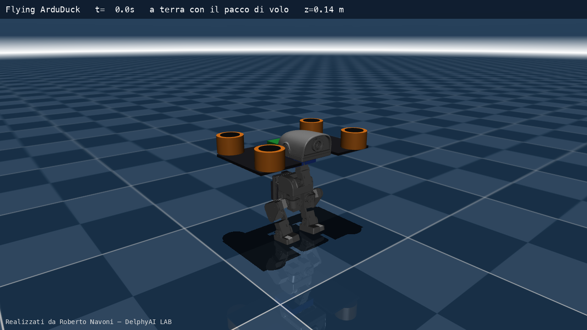
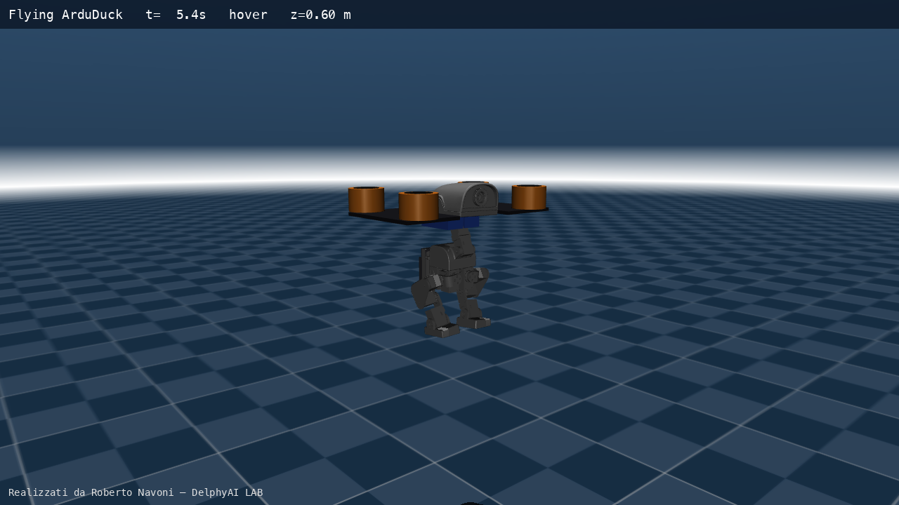
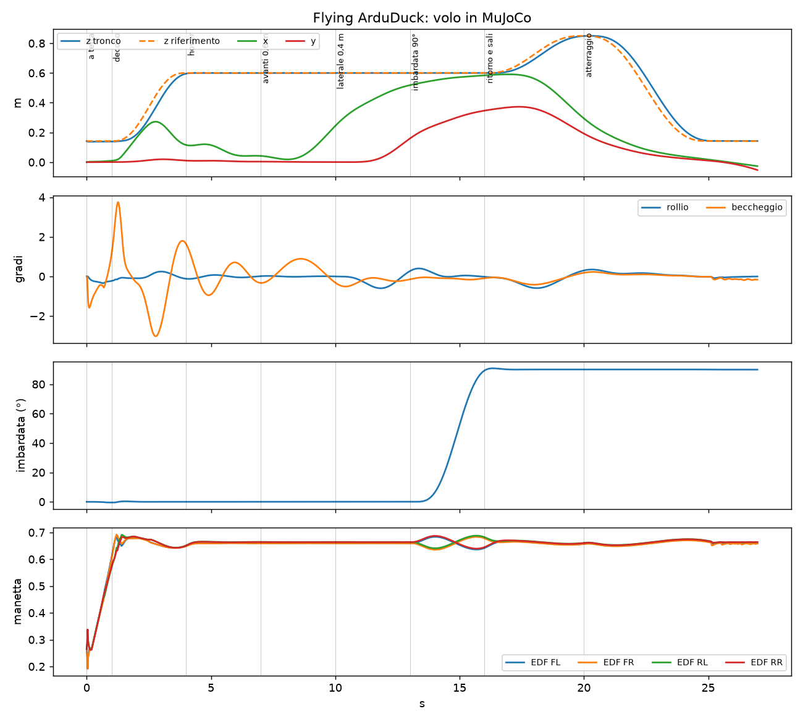

# Flying ArduDuck

[Catalogo robot](README.md) · [Training compatibile con ArduPilot](training.md) · [README](../../README.it.md)



*Modello MuJoCo: XGO Duck con il pacco di volo sul dorso (piastra, due batterie blu, flight controller verde, quattro EDF), vista 3/4 a terra.*



*Hover a 0,60 m (t = 5,4 s del volo simulato).*



*Volo simulato: quota e posizione, assetto, imbardata e manette delle quattro EDF.*

| | |
|---|---|
| Id (cartella) | `flying_arduduck` |
| `NNM_ROBOT` | **23** |
| Classe | bipede |
| Progetto | ArduDuck (XGO Duck su Arduino Uno Q) con il pacco di volo del fork CMU di microduck_rl |
| Stato | modello MuJoCo con pacco di volo (4 EDF) e hover simulato con controllore a cascata; policy delle gambe per il pacco da addestrare |
| Giunti comandati | 14 |
| Osservazione | 61 valori |
| Frequenza policy | 50 Hz |
| Attuatori | 15 servo su bus seriale come l'ArduDuck (14 giunti + bocca) e quattro EDF pilotate dalle uscite motore dell'autopilota (mixer a X) |
| Collegamento | servo su bus seriale dietro lo sketch XDuck dell'Uno Q: backend `AP_JointBus` (`NNM_OUT 1`) |
| Licenza upstream | microduck_rl: Apache-2.0 (Pollen Robotics) con il layer CMU in `cmu/`; xgoduck_rl: Apache-2.0 |

## Repo originale e file di base

- Repository: [github.com/qilinxiaoxiang/microduck_rl](https://github.com/qilinxiaoxiang/microduck_rl)
- Modello MuJoCo e training: [github.com/ZXerniXZ/xgoduck_rl](https://github.com/ZXerniXZ/xgoduck_rl)
- Modello MuJoCo (in questo repo): [`robots/flying_arduduck/robot/flying_arduduck.xml`](../../robots/flying_arduduck/robot/flying_arduduck.xml)
- CAD e parti stampabili: il CAD del pacco (`extensions/flight-20261110`) non è nel fork: sta nel repo `microduck-sim` del progetto CMU. Qui il pacco è ricostruito con scatole e cilindri
- BOM e montaggio: pacco 936 g (fork): 2 batterie di volo da 151 g, 4 EDF, piastra alare, vassoi e flight controller. Il fork dichiara 1,899 kg per il robot CMU con il pacco (0,963 kg senza)
- Training upstream: `cmu/finetune/flight/`: fine-tune di walk61, stand61 e groundpick61 con il carico sul dorso (massa 1,70–2,10 kg randomizzata, COM ±12 mm, costo di coppia sui servo). Non addestra il volo: le EDF non hanno un modello di spinta nel fork
- Policy upstream: nessuna per il pacco (nel fork ci sono solo gli script `cmu/finetune/flight/*.py`)

Per scaricare il repo originale e preparare la scena usata da simulazione e training:

```bash
.venv/bin/python tools/robots/fetch_upstream.py --robot flying_arduduck
```

Nota sul modello: il modello `robots/flying_arduduck/robot/flying_arduduck.xml` è generato da `tools/robots/flying_arduduck_mjcf.py`: parte dal XGO Duck di `xgoduck_rl` (branch hd1910-standup, 0,791 kg, contatti e massa dello stack elettronico come nel training) e aggiunge il pacco: ali laterali libere dalla testa, barra posteriore, due batterie sul dorso, flight controller e quattro EDF a X con asse verso l'alto. Le EDF sono attuatori di spinta sui `site` `thrust_*` (filtro del primo ordine 50 ms, coppia di reazione 0,02 N·m per N con rotazioni alternate). I servo delle gambe hanno kp 3 N·m/rad con il limite di coppia 1,04 N·m del modello. Le EDF sono spostate fino a far coincidere il centroide delle spinte con il baricentro in posa di stand. Rigenerare: `.venv/bin/python tools/robots/flying_arduduck_mjcf.py --write`.

## Volo

Il fork `qilinxiaoxiang/microduck_rl` contiene in `cmu/finetune/flight` la pipeline di fine-tune per un **pacco di volo** (estensione `flight-20261110`: 936 g, quattro EDF, due batterie, piastra alare) che raddoppia la massa del robot. Il fork non include né il CAD né il modello di spinta, quindi qui il pacco è ricostruito sul XGO Duck con le sole cifre dichiarate (massa, batterie, numero di EDF) e con ipotesi esplicite per il resto. Il volo mostrato è un hover con controllore a cascata (quota, posizione, assetto, mixer a X), non una policy addestrata.

| | |
|---|---|
| Massa robot / pacco | 1,727 kg (XGO Duck 0,791 kg + pacco 0,936 kg) |
| Spinta massima | 4 × 6,4 N = 25,6 N (ipotesi): spinta/peso 1,51 |
| Layout EDF | X, quadrato 0,15 × 0,25 m, asse verso l'alto, rotazioni alternate |
| Quota di hover | 0,60 m (tronco), tenuta entro 0,3 mm |
| Inclinazione massima | 3,8° in tutto il volo (decollo, 0,6 m avanti, 0,4 m laterale, 90° di imbardata, salita a 0,85 m) |
| Manette in volo | 0,64–0,69 (le quattro EDF quasi uguali: spinta allineata al baricentro) |
| Atterraggio | a 59 mm dal punto di partenza, sulle suole |

Video del volo simulato: [`docs/media/flying_arduduck_hover.mp4`](../media/flying_arduduck_hover.mp4).

## Topologia

File: [`robots/flying_arduduck/robot/profile.json`](../../robots/flying_arduduck/robot/profile.json) → `robot.bin` sulla microSD. Ordine dei giunti = ordine di osservazione, azione e uscite servo.

| # | Giunto | q0 (rad) | Uscita servo |
|---:|---|---:|---|
| 0 | `left_hip_yaw` | +0.0000 | `SERVO1_FUNCTION 94` |
| 1 | `left_hip_roll` | -0.0873 | `SERVO2_FUNCTION 95` |
| 2 | `left_hip_pitch` | -0.3840 | `SERVO3_FUNCTION 96` |
| 3 | `left_knee` | +0.0000 | `SERVO4_FUNCTION 97` |
| 4 | `left_ankle` | +0.3840 | `SERVO5_FUNCTION 98` |
| 5 | `neck_pitch` | +0.3491 | `SERVO6_FUNCTION 99` |
| 6 | `head_pitch` | +0.3491 | `SERVO7_FUNCTION 100` |
| 7 | `head_yaw` | +0.0000 | `SERVO8_FUNCTION 101` |
| 8 | `head_roll` | +0.0000 | `SERVO9_FUNCTION 102` |
| 9 | `right_hip_yaw` | +0.0000 | `SERVO10_FUNCTION 103` |
| 10 | `right_hip_roll` | +0.0873 | `SERVO11_FUNCTION 104` |
| 11 | `right_hip_pitch` | +0.3840 | `SERVO12_FUNCTION 105` |
| 12 | `right_knee` | +0.0000 | `SERVO13_FUNCTION 106` |
| 13 | `right_ankle` | -0.3840 | `SERVO14_FUNCTION 107` |

Osservazione (61): gyro FLU 3, gravità FLU 3, q−q0 14, q̇ 14, azione precedente 14, twist vx vy ωz 3, come `xgoduck`: orologio 2 + comando testa 4 (`NNM_POSE`) + 4 canali non usati.
Azione (14): offset in radianti, `q_target = q0 + azione`.

## Architettura PPO

File: [`robots/flying_arduduck/robot/ppo.yaml`](../../robots/flying_arduduck/robot/ppo.yaml). Stessa rete di MicroDuck, già provata su Pixhawk 6C: **61 → 512 → 256 → 128 → 14**, ELU, normalizzazione dell'osservazione incorporata. Pesi int8 per riga addestrati sulla griglia int8 dalla prima iterazione (QAT), attivazioni float32. PPO: 2048 ambienti × 24 passi, 5 epoche, 4 minibatch, lr 1e-3 adattivo (KL 0,01), γ 0,99, λ 0,95, clip 0,2.

## Policy

Cartella: [`robots/flying_arduduck/policies/`](../../robots/flying_arduduck/policies/) → sulla microSD `/APM/nnm/flying_arduduck/policies/`. `NNM_POLICY` = indice del file in ordine alfabetico.

Nessuna policy ancora: va addestrata (sezione successiva).

## Training compatibile con ArduPilot

L'ambiente è già il deployment: fisica a 200 Hz come il loop dell'autopilota, gravità dal filtro IMU del firmware, azione tagliata a `NNM_ACT_MAX` e codificata in PWM, osservazione nell'ordine del profilo. Dettagli in [training.md](training.md).

```bash
.venv/bin/python tools/robots/nnm_env.py --robot flying_arduduck                       # carica la scena, passo a policy zero
.venv/bin/python tools/robots/train_velocity.py --robot flying_arduduck --envs 8 --iters 200 --name walk
.venv/bin/python tools/robots/train_velocity.py --robot flying_arduduck --eval robots/flying_arduduck/policies/walk.nnm
```

Il trainer CPU serve per verifiche e rifiniture brevi. Per una policy completa (2048 ambienti × 2000 iterazioni) si usa mjlab su GPU con gli stessi due pezzi: `deploy_contract.py` per osservazione e azione, `nnm_qat.enable_qat()` sull'actor, `export_nnm_from_actor()` per il file.

## Deploy sull'autopilota

```bash
python tools/robots/pack_robot_bin.py --robot flying_arduduck          # robot.bin dal profilo
# microSD: /APM/nnm/flying_arduduck/robot.bin  e  /APM/nnm/flying_arduduck/policies/*.nnm
```

Parametri: `NNM_ENABLE 1`, `NNM_ROBOT 23` (riavvio), `NNM_POLICY 0`, `SERVO1..14_FUNCTION 94..107`, `INS_GYRO_FILTER 0`, `SCHED_LOOP_RATE 200`.

## Note

- Contratto uguale a `xgoduck` (14 giunti, 61 valori): le otto policy dell'app XDuck si caricano senza cambiare nulla. Le EDF non fanno parte della rete: le comanda l'autopilota con il mixer a X (quattro uscite motore), come un multirotore.
- Le gambe non sono addestrate per il pacco. Il fork lo fa per il MicroDuck CMU (`walk61`, `stand61`, `groundpick61` con carico 1,70–2,10 kg randomizzato): per il Flying ArduDuck servono lo stesso fine-tune sul modello `flying_arduduck.xml` e il manifest vero del pacco.
- Ipotesi da sostituire con misure: spinta 6,4 N per EDF (circa 0,65 kgf), massa EDF 85 g, costante di tempo 50 ms, coppia di reazione 0,02 N·m per N, geometria di piastra, vassoio e gondole. Il baricentro dei servo in volo e la curva spinta/PWM reali cambiano i guadagni del controllore.
- Nel modello i servo delle gambe tengono la posa di stand con kp 3 N·m/rad (il modello da sola visualizzazione di `xgoduck_rl` usa 0,84 e cede sotto 1,7 kg). Il training usa BAM; qui non serve.
- Il volo è un hover con controllore a cascata nel loop a 200 Hz: quota PD con peso in feed-forward, posizione PD su un riferimento di inclinazione, assetto PD con integrale, mixer a X con coppia di imbardata dalle rotazioni alternate. Provarlo: `.venv/bin/mjpython tools/robots/flying_arduduck_mjcf.py --view`.
