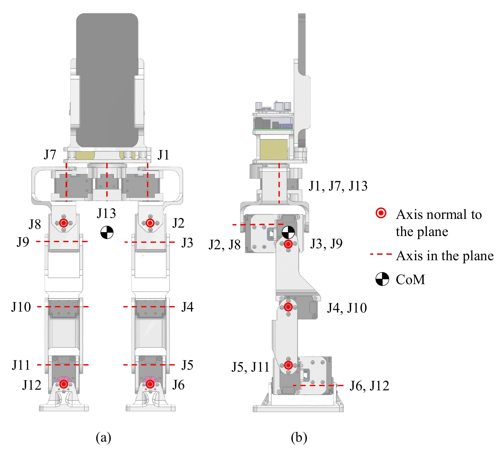

# PhoneBot

[Catalogo robot](README.md) · [Training compatibile con ArduPilot](training.md) · [README](../../README.it.md)



*PhoneBot, render hardware sul sito ufficiale. Foto: [phonebot.dev/](https://phonebot.dev/).*

| | |
|---|---|
| Id (cartella) | `phonebot` |
| `NNM_ROBOT` | **18** |
| Classe | bipede |
| Progetto | UCLA RoMeLa (Ruochen Hou, Quanyou Wang, Daniel Koh, Dennis Hong) |
| Stato | scena MuJoCo ricostruita dalla cinematica upstream; policy da addestrare |
| Giunti comandati | 13 |
| Osservazione | 50 valori |
| Frequenza policy | 50 Hz |
| Attuatori | 13× DYNAMIXEL XL430-W250-T, ordine del disegno hardware: J1–J6 gamba destra, J7–J12 gamba sinistra (yaw, roll, pitch, ginocchio, caviglia pitch, caviglia roll), J13 yaw del busto. Limite anca pitch: J3 −90°..+123°, J9 −123°..+90°. Sull'hardware: backend Dynamixel TTL su Pixhawk |
| Collegamento | servo su bus seriale: serve il backend bus nel firmware (non ancora scritto) |
| Licenza upstream | CAD, STEP, BOM e guide: CC BY-NC 4.0; software promesso come open source ma nessun repository pubblico è linkato al 24 ottobre 2026 |

## Repo originale e file di base

- Repository: [phonebot.dev/](https://phonebot.dev/)
- Modello MuJoCo (in questo repo): [`robots/phonebot/robot/phonebot.xml`](../../robots/phonebot/robot/phonebot.xml)
- CAD e parti stampabili: phonebot.dev/assets/models/PhoneBot-preview.glb (anteprima, 12 mesh), assets/PhoneBot_Asm.glb (assemblato completo), assets/PhoneBot_Assembly_STEP.zip e assets/Phonebot_BOM.xlsx (CC BY-NC 4.0); Onshape e STL non pubblicati al 24 ottobre 2026
- BOM e montaggio: 13× DYNAMIXEL XL430-W250-T, batteria 3S, U2D2 e SBC; 48,3 cm, 1,8 kg incluso smartphone, ≈400 USD escluso telefono. Il nostro assetto usa Pixhawk + ESP32, non l'SBC upstream
- Training upstream: PPO asimmetrico MJX/MuJoCo a 50 Hz: attore 52 (gyro 3, gravità 3, comando 3, q/qdot/azione precedente 39, fase piedi 4) → 13, critico 120; modello XL430 torque-aware, randomizzazione di guadagni, limiti, backlash e spinte; mirror sagittale del batch
- Policy upstream: policy TensorFlow Lite descritta nel paper ma pesi/repository non pubblicati; 52 → 13, ordine e fase differenti dal contratto NNMixer; da riaddestrare

Per scaricare il repo originale e preparare la scena usata da simulazione e training:

```bash
.venv/bin/python tools/robots/fetch_upstream.py --robot phonebot
```

Nota sul modello: nessun MJCF/URDF ufficiale. phonebot.xml usa le mesh del GLB di anteprima ufficiale, tagliate sui 13 link: ogni giunto sta sull'albero di uscita del suo XL430 nel GLB (coscia 78 mm, tibia 71 mm). Masse e collisioni sono box approssimati, da calibrare sul robot.

## Topologia

File: [`robots/phonebot/robot/profile.json`](../../robots/phonebot/robot/profile.json) → `robot.bin` sulla microSD. Ordine dei giunti = ordine di osservazione, azione e uscite servo.

| # | Giunto | q0 (rad) | Uscita servo |
|---:|---|---:|---|
| 0 | `right_hip_yaw` | +0.0000 | `SERVO1_FUNCTION 94` |
| 1 | `right_hip_roll` | +0.0000 | `SERVO2_FUNCTION 95` |
| 2 | `right_hip_pitch` | -0.5000 | `SERVO3_FUNCTION 96` |
| 3 | `right_knee_pitch` | +1.0000 | `SERVO4_FUNCTION 97` |
| 4 | `right_ankle_pitch` | -0.5000 | `SERVO5_FUNCTION 98` |
| 5 | `right_ankle_roll` | +0.0000 | `SERVO6_FUNCTION 99` |
| 6 | `left_hip_yaw` | +0.0000 | `SERVO7_FUNCTION 100` |
| 7 | `left_hip_roll` | +0.0000 | `SERVO8_FUNCTION 101` |
| 8 | `left_hip_pitch` | -0.5000 | `SERVO9_FUNCTION 102` |
| 9 | `left_knee_pitch` | +1.0000 | `SERVO10_FUNCTION 103` |
| 10 | `left_ankle_pitch` | -0.5000 | `SERVO11_FUNCTION 104` |
| 11 | `left_ankle_roll` | +0.0000 | `SERVO12_FUNCTION 105` |
| 12 | `torso_yaw` | +0.0000 | `SERVO13_FUNCTION 106` |

Osservazione (50): gyro FLU 3, gravità FLU 3, q−q0 13, q̇ 13, azione precedente 13, twist vx vy ωz 3, orologio del passo sin, cos 2 (`NNM_CLOCK_HZ`; zero da fermi).
Azione (13): offset in radianti, `q_target = q0 + azione`.

## Architettura PPO

File: [`robots/phonebot/robot/ppo.yaml`](../../robots/phonebot/robot/ppo.yaml). Stessa rete di MicroDuck, già provata su Pixhawk 6C: **50 → 512 → 256 → 128 → 13**, ELU, normalizzazione dell'osservazione incorporata. Pesi int8 per riga addestrati sulla griglia int8 dalla prima iterazione (QAT), attivazioni float32. PPO: 2048 ambienti × 24 passi, 5 epoche, 4 minibatch, lr 1e-3 adattivo (KL 0,01), γ 0,99, λ 0,95, clip 0,2.

## Policy

Cartella: [`robots/phonebot/policies/`](../../robots/phonebot/policies/) → sulla microSD `/APM/nnm/phonebot/policies/`. `NNM_POLICY` = indice del file in ordine alfabetico.

| File | Dimensione | Descrizione |
|---|---:|---|
| `walk.nnm` | 194 KB |  |
| `walk_air.nnm` | 194 KB |  |
| `walk_fwd.nnm` | 194 KB |  |
| `walk_fwd_it0800.nnm` | 194 KB |  |
| `walk_natural.nnm` | 194 KB |  |
| `walk_slow.nnm` | 194 KB |  |
| `walk_steps.nnm` | 194 KB |  |
| `walk_steps2.nnm` | 194 KB |  |
| `walk_track.nnm` | 194 KB |  |

## Training compatibile con ArduPilot

L'ambiente è già il deployment: fisica a 200 Hz come il loop dell'autopilota, gravità dal filtro IMU del firmware, azione tagliata a `NNM_ACT_MAX` e codificata in PWM, osservazione nell'ordine del profilo. Dettagli in [training.md](training.md).

```bash
.venv/bin/python tools/robots/nnm_env.py --robot phonebot                       # carica la scena, passo a policy zero
.venv/bin/python tools/robots/train_velocity.py --robot phonebot --envs 8 --iters 200 --name walk
.venv/bin/python tools/robots/train_velocity.py --robot phonebot --eval robots/phonebot/policies/walk.nnm
```

Il trainer CPU serve per verifiche e rifiniture brevi. Per una policy completa (2048 ambienti × 2000 iterazioni) si usa mjlab su GPU con gli stessi due pezzi: `deploy_contract.py` per osservazione e azione, `nnm_qat.enable_qat()` sull'actor, `export_nnm_from_actor()` per il file.

## Deploy sull'autopilota

```bash
python tools/robots/pack_robot_bin.py --robot phonebot          # robot.bin dal profilo
# microSD: /APM/nnm/phonebot/robot.bin  e  /APM/nnm/phonebot/policies/*.nnm
```

Parametri: `NNM_ENABLE 1`, `NNM_ROBOT 18` (riavvio), `NNM_POLICY 0`, `SERVO1..13_FUNCTION 94..106`, `INS_GYRO_FILTER 0`, `SCHED_LOOP_RATE 200`.

## Note

- Architettura prevista: Pixhawk esegue NNMixer, legge l'IMU fissata al busto e comanda il bus Dynamixel; ESP32 su UART telemetria espone MAVLink 2 via Bluetooth Classic e Wi-Fi. Il telefono prima è il telecomando (`MANUAL_CONTROL`), poi, nella custodia sul busto, resta client MAVLink per camera, UI e percezione; non chiude il ciclo PPO a 50 Hz. Architettura: [phonebot-pixhawk-phone.md](../reference/phonebot-pixhawk-phone.md).
- Il telefono può inviare twist, heading, `VISION_POSITION_ESTIMATE` e `OBSTACLE_DISTANCE`; camera e ARCore non attraversano Bluetooth. I dati non critici passano su MAVLink; gyro, gravità e feedback servo restano nel Pixhawk per evitare jitter wireless nel contratto della policy.
- 13 giunti e osservazione 50 (48 di base + sin/cos) stanno nei limiti firmware. La prima policy ArduPilot usa l'orologio `NNM_CLOCK_HZ` già presente e un premio per l'alternanza dei due piedi. L'attore PhoneBot originale usa quattro fasi: per replicarlo serve estendere il firmware.
- Geometria e assi dei giunti vengono dal GLB ufficiale; masse, inerzie e q0 sono stimati. Non usare una policy addestrata su questa scena sul robot prima di pesare i link e calibrare q0.
- `home_z` 0,28 m è l'altezza del bacino con q0 (0,277 m) più qualche millimetro di caduta; il paper indica 0,282 m con la sua posa di riposo.
- Il paper usa una policy torque-aware (XL430 limitato in coppia e velocità), mentre l'ambiente corrente applica un PD con taglio ±1,4 N·m. Portare curva coppia-velocità, backlash e mirror sagittale è necessario prima di mirare al sim-to-real.
