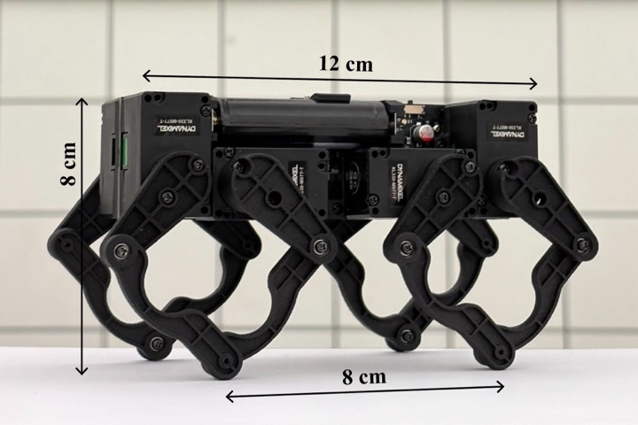
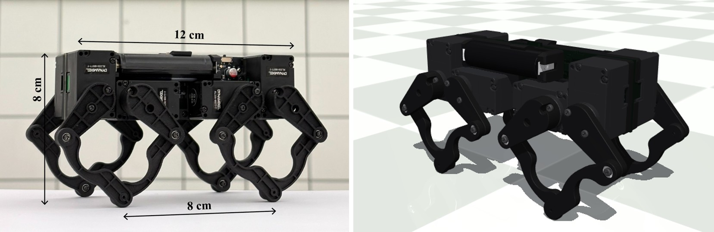
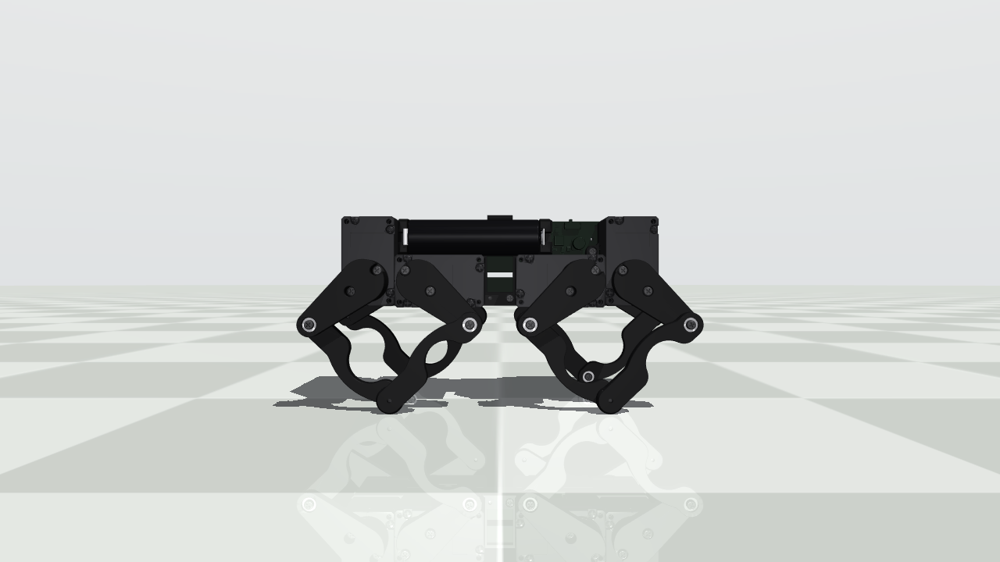

# Q8bot

[Catalogo robot](README.md) · [Training compatibile con ArduPilot](training.md) · [README](../../README.it.md)



*Q8bot, robot montato, con le quote del README (12 × 8 cm, alto 8 cm). Foto: [github.com/EricYufengWu/q8bot](https://github.com/EricYufengWu/q8bot).*



*Foto del Q8bot (a sinistra) e modello MuJoCo con le mesh del CAD hw-v2.5 e i servo HD-1910M (a destra), vista 3/4.*



*Modello MuJoCo, vista laterale, in posa di stand a 48 mm.*

| | |
|---|---|
| Id (cartella) | `q8bot` |
| `NNM_ROBOT` | **22** |
| Classe | quadrupede |
| Progetto | Yufeng (Eric) Wu, UCLA RoMeLa |
| Stato | scena MuJoCo ricostruita dalla cinematica upstream; policy da addestrare |
| Giunti comandati | 8 |
| Osservazione | 33 valori |
| Frequenza policy | 50 Hz |
| Attuatori | 8× Feetech HD-1910M (HD-1910-C001), lo stesso servo di MicroDuck / XGO Duck, al posto degli XL330-M077-T del progetto originale. Bus seriale Feetech a 1 Mbps, 7,4 V, ID 11–18 nell'ordine dei giunti (FL, FR, BL, BR; q1 poi q2). Squadretta montata con l'asta verso terra a centro corsa: conteggio = 2048 + θ × 4096/360. MCU di bordo upstream: Seeed XIAO ESP32C3 |
| Collegamento | servo su bus seriale: serve il backend bus nel firmware (non ancora scritto) |
| Licenza upstream | MIT |

## Repo originale e file di base

- Repository: [github.com/EricYufengWu/q8bot](https://github.com/EricYufengWu/q8bot)
- Modello MuJoCo (in questo repo): [`robots/q8bot/robot/q8bot.xml`](../../robots/q8bot/robot/q8bot.xml)
- CAD e parti stampabili: STEP e STL nella release hardware (https://github.com/EricYufengWu/q8bot/releases), cartella hw-vx.x/CAD; parti da stampare Q8bt_Frame ×2, Q8bot_LL_Left/Right ×4, Q8bot_UL1/UL2 ×4
- BOM e montaggio: foglio [docs.google.com/spreadsheets/d/1M1K_Dghia-Mn2t4RStW8juN6r4e3I3OBy6M_fPFHzs8](https://docs.google.com/spreadsheets/d/1M1K_Dghia-Mn2t4RStW8juN6r4e3I3OBy6M_fPFHzs8) e docs/instructions/sourcing_components.md: 8× XL330-M077-T, 12 cuscinetti 692ZZ, 2× 14500 1000 mAh, PCB con XIAO ESP32C3. Costo dichiarato 300–400 $
- Training upstream: non c'è un training: i passi (trotto, camminata, crawl, bound, pronk) sono traiettorie IK precalcolate in gait_generator.py e suonate a 200 Hz da operate.py (pygame SPEED). Il salto è una sequenza nel firmware (idle 30°/150°, basso −40°/220°, alto 90°/90°)
- Policy upstream: nessuna

Per scaricare il repo originale e preparare la scena usata da simulazione e training:

```bash
.venv/bin/python tools/robots/fetch_upstream.py --robot q8bot
```

Nota sul modello: nessun MJCF, URDF o mesh nel git (STEP, STL e Gerber stanno nelle release hardware): il modello robots/q8bot/robot/q8bot.xml è costruito da tools/robots/q8bot_mjcf.py e versionato in questo repo. Le visuali sono le parti dell'assieme STEP della release hw-v2.5 (telaio, PCB, celle, aste, cuscinetti, viti), esportate con le loro pose da tools/robots/q8bot_step_export.py in robots/q8bot/robot/meshes. Ogni zampa è un pentagono articolato chiuso (due motori, interasse 19,5 mm, aste 25 e 40 mm: il CAD e python-tools/q8bot/kinematics_solver.py coincidono) chiuso con un `equality connect` sul piede; i giunti comandati sono i due angoli motore del firmware, riferiti alla verticale (θ = q − 90°). I servo sono Feetech HD-1910M al posto degli XL330: dinamica dal modello BAM `hd1910_m6.json` (xgoduck_rl, Apache 2.0), massa 21 g l'uno; sono disegnati con il corpo CAD dell'XL330 (stessa faccia 34 × 20 mm, 3 mm più profondo). Per cambiare masse, servo o misure si modifica lo script e si rigenera: `.venv/bin/python tools/robots/q8bot_mjcf.py --demo`.

## Topologia

File: [`robots/q8bot/robot/profile.json`](../../robots/q8bot/robot/profile.json) → `robot.bin` sulla microSD. Ordine dei giunti = ordine di osservazione, azione e uscite servo.

| # | Giunto | q0 (rad) | Uscita servo |
|---:|---|---:|---|
| 0 | `FL_q1` | -0.8828 | `SERVO1_FUNCTION 94` |
| 1 | `FL_q2` | +0.8828 | `SERVO2_FUNCTION 95` |
| 2 | `FR_q1` | -0.8828 | `SERVO3_FUNCTION 96` |
| 3 | `FR_q2` | +0.8828 | `SERVO4_FUNCTION 97` |
| 4 | `BL_q1` | -0.8828 | `SERVO5_FUNCTION 98` |
| 5 | `BL_q2` | +0.8828 | `SERVO6_FUNCTION 99` |
| 6 | `BR_q1` | -0.8828 | `SERVO7_FUNCTION 100` |
| 7 | `BR_q2` | +0.8828 | `SERVO8_FUNCTION 101` |

Osservazione (33): gyro FLU 3, gravità FLU 3, q−q0 8, q̇ 8, azione precedente 8, twist vx vy ωz 3.
Azione (8): offset in radianti, `q_target = q0 + azione`.

## Modello meccanico e confronto con Petoi Bittle (OpenCat)

| Grandezza | Q8bot | Petoi Bittle (OpenCat) | Fonte |
|---|---|---|---|
| Gradi di libertà per zampa | 2 motori su un pentagono chiuso (q1, q2); nessun ginocchio seriale | 2 seriali: spalla, ginocchio | kinematics_solver.py |
| Giunti comandati | 8 | 8 | q8Dynamixel.h `_idCount` |
| Interasse dei due motori | 19,5 mm | — | `CENTER_DIST` in operate.py |
| Aste superiore / inferiore | 25 / 40 mm | coscia 46 mm, tibia 29 mm | `L1`, `L2` |
| Piede in stand rispetto ai motori | a metà interasse, 43,4 mm sotto | posa `balance` | GAITS['TROT']: x0, y0 |
| Ingombro | 12 × 8 cm, alto 8 cm | tronco a 47 mm | Q8bot_Hero_With_Dimension.jpg |
| Massa | 245 g con le batterie (221 g pubblicati con gli XL330, + 8 × 3 g) | 273,5 g | Q8bot_Weight.jpg |
| Servo | Feetech HD-1910M (upstream: XL330-M077-T) | Petoi P1S, ≈ 0,27 N·m | sourcing_components.md |
| IMU | nessuna (solo gauge MAX17043): nella scena è virtuale, sul tronco | MPU6050 | firmware q8bot_robot |
| Coppia servo nel modello | 1,47 N·m di stallo, 11,8 rad/s a vuoto (7,4 V); l'XL330 a 3,7 V: 0,18 N·m e 29 rad/s | ≈ 0,27 N·m | scheda Feetech HD-1910-C001, BAM hd1910_m6.json |
| Anello di controllo upstream | IK open-loop a 200 Hz via ESP-NOW, dal laptop | tabelle OpenCat a 50 Hz sulla NyBoard | operate.py `SPEED` |

## Architettura PPO

File: [`robots/q8bot/robot/ppo.yaml`](../../robots/q8bot/robot/ppo.yaml). Stessa rete di MicroDuck, già provata su Pixhawk 6C: **33 → 512 → 256 → 128 → 8**, ELU, normalizzazione dell'osservazione incorporata. Pesi int8 per riga addestrati sulla griglia int8 dalla prima iterazione (QAT), attivazioni float32. PPO: 2048 ambienti × 24 passi, 5 epoche, 4 minibatch, lr 1e-3 adattivo (KL 0,01), γ 0,99, λ 0,95, clip 0,2.

## Policy

Cartella: [`robots/q8bot/policies/`](../../robots/q8bot/policies/) → sulla microSD `/APM/nnm/q8bot/policies/`. `NNM_POLICY` = indice del file in ordine alfabetico.

Nessuna policy ancora: va addestrata (sezione successiva).

### Risultati per versione di ambiente ed epoca

Ogni link è la policy int8, quella che gira sull'autopilota, a quel checkpoint. La versione è la configurazione di reward e comandi di quel run (`robots/q8bot/robot/ppo.yaml` ne tiene l'ultima). Un'iterazione di training esegue 5 epoche PPO.

| Versione ambiente | Iterazione | Epoche PPO | Video | Risultato |
|---|---:|---:|---|---|
| `modello (trotto upstream open-loop, servo HD-1910M)` | — | — | [`q8bot_model_demo.mp4`](../media/q8bot_model_demo.mp4) | Verifica del modello, 25,5 s: avanti, indietro e rotazione con `GAITS['TROT']` di gait_manager.py (45 campioni a 200 Hz, passo 40 mm, alzata 20 mm), poi le stesse tre mosse con `TROT_LOW` (tronco a 27 mm, passo 20 mm). Alto: 10,8 cm/s avanti, 10,5 indietro, 66°/s in rotazione; basso: 5,7 e 5,5 cm/s, 40°/s. Nessuna caduta, inclinazione massima 7,9° nei tratti di marcia (11,9° mentre si abbassa), pentagoni chiusi entro 0,34 mm. I servo inseguono la traiettoria con circa 20° di ritardo medio: per questo va a un terzo della velocità dell'originale. Rigenerabile con `tools/robots/q8bot_mjcf.py --video`. |

## Training compatibile con ArduPilot

L'ambiente è già il deployment: fisica a 200 Hz come il loop dell'autopilota, gravità dal filtro IMU del firmware, azione tagliata a `NNM_ACT_MAX` e codificata in PWM, osservazione nell'ordine del profilo. Dettagli in [training.md](training.md).

```bash
.venv/bin/python tools/robots/nnm_env.py --robot q8bot                       # carica la scena, passo a policy zero
.venv/bin/python tools/robots/train_velocity.py --robot q8bot --envs 8 --iters 200 --name walk
.venv/bin/python tools/robots/train_velocity.py --robot q8bot --eval robots/q8bot/policies/walk.nnm
```

Il trainer CPU serve per verifiche e rifiniture brevi. Per una policy completa (2048 ambienti × 2000 iterazioni) si usa mjlab su GPU con gli stessi due pezzi: `deploy_contract.py` per osservazione e azione, `nnm_qat.enable_qat()` sull'actor, `export_nnm_from_actor()` per il file.

## Deploy sull'autopilota

```bash
python tools/robots/pack_robot_bin.py --robot q8bot          # robot.bin dal profilo
# microSD: /APM/nnm/q8bot/robot.bin  e  /APM/nnm/q8bot/policies/*.nnm
```

Parametri: `NNM_ENABLE 1`, `NNM_ROBOT 22` (riavvio), `NNM_POLICY 0`, `SERVO1..8_FUNCTION 94..101`, `INS_GYRO_FILTER 0`, `SCHED_LOOP_RATE 200`.

## Note

- Quadrupede da palmo, senza cavi: nel progetto originale gli 8 Dynamixel si innestano sulla PCB centrale. Il controllo pubblicato non è una policy: il laptop risolve l'IK e manda 8 angoli al XIAO di bordo via ESP-NOW.
- Contratto a 8 giunti, osservazione 33, dentro `NNM_MAX_JOINTS` 20. I giunti sono gli angoli dei due motori del pentagono (a meno dei 90° di offset), gli stessi che il firmware scrive come goal position: non vanno rimappati su un'anca e un ginocchio seriali.
- q0 è lo stand del trotto di default (39,42° e 140,58° su ogni zampa, misurati da +x come in `kinematics_solver.py`). La posa di riposo del firmware e del salto è un'altra: 30° e 150° (`_idlePos` in q8Dynamixel.h).
- Angolo del contratto θ = q − 90° (angolo dalla verticale): −50,58° e +50,58° allo stand. Il bersaglio viaggia come PWM da ±2,1 rad attorno a zero e 140,58° (2,45 rad) verrebbe tagliato a 120°. Con gli HD-1910M la squadretta si monta con θ = 0 a centro corsa (2048) e i 90° non servono; con gli XL330 originali il backend li aggiunge: conteggio = 4096 + (θ + 90°) × 4096/360.
- Nessuna IMU a bordo. Nel contratto la gravità e il giroscopio arrivano dall'autopilota: nella scena sono un giroscopio e un accelerometro virtuali sul tronco (`imu_gyro`, `imu_acc`). Sul robot va montata una IMU sul tronco (o l'autopilota stesso), con lo stesso asse della scena: x avanti, y a sinistra, z in alto; senza, la policy va addestrata senza contarci.
- Zampe planari: niente velocità laterale. La rotazione upstream è un passo più corto da un lato (gait `fl_0.75`, `fr_0.5`, …), non un'abduzione.
- Scena MuJoCo `q8bot.xml`: le parti dell'assieme CAD hw-v2.5 nelle loro pose (telaio in due metà, PCB, due celle 14500, otto servo, aste, cuscinetti e viti), 245 g. I due motori A (q1, davanti) e B (q2, dietro) stanno a 19,5 mm; θ = 0 è l'asta verso terra, θ positivo la porta indietro. Toccano il pavimento solo il tronco e il piede (sfera r 5 mm sul pivot); le aste non si urtano tra loro. Le collisioni sono capsule e una sfera, le masse stanno su scatole grandi come le parti.
- Servo HD-1910M al posto degli XL330: 21 g, 1,47 N·m di stallo e 11,8 rad/s a vuoto a 7,4 V. Otto volte la coppia, meno di metà della velocità. In simulazione usano il modello BAM identificato sul 1910 per XGO Duck (`hd1910_m6.json`, guadagno firmware 5), lo stesso di `xgoduck`.
- Prova della scena (`q8bot_mjcf.py --demo`): il trotto upstream a 200 campioni/s avanza a 10,8 cm/s, arretra a 10,5 cm/s e ruota a 66°/s; nella posa bassa (`TROT_LOW`) 5,7 cm/s, 5,5 cm/s e 40°/s. L'originale con gli XL330 fa circa 29 cm/s: il 1910 è più lento e insegue la traiettoria con circa 20° di ritardo medio, quindi il passo si accorcia. Alzare il guadagno del servo non aiuta: con guadagno 16 a questa cadenza il robot si ribalta in rotazione. Pentagono chiuso entro 0,34 mm in marcia, 0,09 mm da fermo.
- Da verificare sul robot. Il telaio e la PCB della release sono fatti per l'XL330 (20 × 34 × 26 mm, innesto diretto sulla scheda): l'HD-1910M è 34 × 20 × 23 mm con altri fori e un altro connettore, quindi il telaio va ridisegnato e nel modello il servo ha ancora la forma dell'XL330. Le due celle vanno in serie per i 7,4 V. Sono stime anche la massa delle celle (21 g), il riempimento PLA (il resto dei 221 g pubblicati ripartito sui volumi del CAD) e l'attrito dei cuscinetti.
- Bus Feetech, lo stesso di MicroDuck e XGO Duck: sul robot vale lo stesso backend. Gli 8 servo stanno nelle 16 funzioni Scripting, quindi SITL e HIL non aspettano il backend.
- Citare i due paper del progetto: design, IROS 2025 (arXiv:2508.01149); controllo e acquisizione dati, UR 2025.
